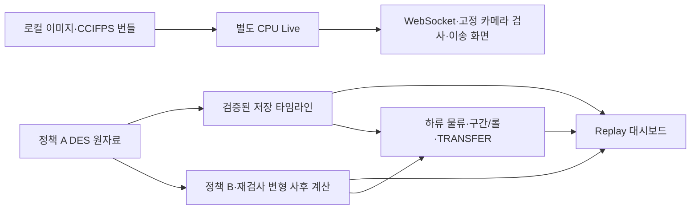

# CNOTTA × ARIA

**비전 이상 탐지 결과를 공정·검사 설비·물류 흐름으로 연결하는 디지털 트윈 연구 워크스페이스입니다.**

ARIA는 CCIFPS, 코어셋, `random_same_k`의 저장 결과를 비교하고, CNOTTA 캠퍼스에서 제품 이동·판정·재검사 대기열을 재생합니다. 별도의 CPU Live 모드에서는 실제 BOTTLE 이미지를 검사합니다. 현재 개발 브랜치는 **`dt-cnotta`**입니다.

[최신 BuildSpec](docs/specs/CNOTTA_ARIA_Autopilot_BuildSpec.md) · [구현·검증 보고서](docs/autopilot/STATIONS_REPORT.md) · [진행 기록](docs/autopilot/PROGRESS.md) · [제약·미완료 항목](docs/autopilot/BLOCKERS.md)

## 현재 구성

| 영역 | 구현 내용 |
|---|---|
| 캠퍼스 | `campus.layout.json`으로 배치한 3개 공장, 홀 진입·지붕 페이드·미니맵 |
| 모델 비교 | 각 공장의 코어셋·CCIFPS·`random_same_k` 3개 레인, 총 9개 저장 실행 |
| 1공장 BOTTLE | 비전 터널, 상부 고정 카메라·링 조명, NG 푸셔, HOLD 게이트 |
| 2공장 SCREW | 볼 피더, 유리 원판 원호 경로, 상부 카메라, 에어 노즐, OK 통 |
| 3공장 CARPET | 언와인더, 라인 카메라·조명, 결함 라벨, 리와인더, 롤 등급별 적재 |
| 검사 근거 | 원본 해상도·모델·임계값, 최근 판정 10개 입력/히트맵, 지연 p50/p95 |
| 이송 로봇 | 별도 7단계 `TRANSFER`, 박스·통·롤·재검사 부품 ID 추적 |
| 하류 물류 | 저장 A/B 출구에서 포장·팔레트·지게차·트럭 계산, 제품별 화면 매핑 |
| CPU Live | BOTTLE CCIFPS 1개 레인의 실제 검사, WebSocket 상태, 순찰·고장·복구 |

카메라는 데이터셋과 같은 **수직 하향 방향**입니다. 검사는 고정 카메라가 담당하고, 로봇은 이송·적재를 담당합니다. 현재 스테이션은 코드로 만든 일반 설비 형상이며 실존 장비 제품의 외형·로고를 복제하지 않습니다. CNOTTA 로고는 교체 가능한 임시 SVG입니다.

## Replay와 Live의 차이

| | Replay | CPU Live |
|---|---|---|
| 입력 | 해시 검증된 저장 실행·예측·지연 프로파일 | 로컬 BOTTLE 이미지와 검증된 CCIFPS 모델 번들 |
| 검사 | 저장 판정과 히트맵을 재생 | 기존 검출기로 실제 CPU 추론 |
| 범위 | 3개 클래스 × 3개 모델 | BOTTLE CCIFPS 1개 레인 |
| 시간 | 저장 실행의 공유 sim 시계, 시각 이동·배속 | 별도 시연용 DES의 서버 시계 |
| 실행 방법 | 홀 선택 후 하단 **재생** | 상단 **Live 운영** → **Live 시작** |

Replay의 3D 장면은 저장 결과의 시각화입니다. Live는 연구 본 실행과 분리된 시연이며, 연구 결과를 생성하거나 수정하지 않습니다. 모델과 입력이 준비되지 않은 검사를 가짜 OK/NG로 대체하지 않습니다.



## 실행 준비

검증 환경은 **Python 3.10, Node.js 20, Linux**입니다. Python 의존성이 준비된 격리 환경과 프런트엔드 로컬 의존성을 사용합니다. [requirements.txt](requirements.txt)는 연구·기존 Factory 기능까지 포함하고 `faiss-gpu` 등 환경별 설치가 필요한 항목이 있으므로, 모든 OS에서 동일하게 설치되는 잠금 파일은 아닙니다.

**Git 클론에는 연구 원자료·데이터셋·모델 가중치가 포함되지 않습니다.** 새 클론에서 데이터가 있는 화면을 실행하려면 아래 자산을 별도로 준비해야 합니다.

| 자산 | 연결 위치 / 설정 |
|---|---|
| 검증된 파일럿 A 실행 | `CNOTTA_PILOT` → `runs/*/complete.json`과 원자료가 있는 폴더 |
| P1 예측·GT·저장 히트맵 | `CNOTTA_P1` → 클래스별 `complete.json`, 모델별 예측·맵 |
| 본 실험 결과 | `CNOTTA_RESULTS` → 실행 폴더·완료/검증 마커·집계·REPORT |
| 데이터셋 이미지 | 저장소의 `data/bottle`, `data/screw`, `data/carpet` |
| Live 모델 | `banks/ccifps/<run_id>/`의 완료 번들과 manifest가 참조하는 가중치 |

Live의 모델 ID는 [configs/live_ops.json](configs/live_ops.json)에 있습니다. 번들의 bank·가중치 해시와 경로가 맞아야 합니다. Live 입력 순서는 시연용이며 연구의 불량률 5% 재샘플링과 구분합니다. 기존 작업 환경의 데이터 기본 경로는 [scripts/demo.sh](scripts/demo.sh)에서 확인할 수 있습니다.

## 대시보드 시작

```bash
git clone --branch dt-cnotta https://github.com/JUNGSEHOON-AutoML/Aria-virual-industrial.git
cd Aria-virual-industrial

# 프로젝트 Python 의존성이 준비된 격리 환경을 활성화합니다.
conda activate aria

# 새 체크아웃에서 프런트엔드 의존성 준비
cd frontend
npm ci
cd ..

export CNOTTA_PYTHON="$(command -v python)"
export CNOTTA_NODE="$(command -v node)"
export CNOTTA_PILOT=/absolute/path/to/des_pilot30
export CNOTTA_P1=/absolute/path/to/p1_verified
export CNOTTA_RESULTS=/absolute/path/to/completed_policy_a_results

bash scripts/demo.sh
```

- 대시보드: [http://127.0.0.1:5278/cnotta.html](http://127.0.0.1:5278/cnotta.html)
- Live: [http://127.0.0.1:5278/cnotta.html?mode=live](http://127.0.0.1:5278/cnotta.html?mode=live)
- API 문서: [http://127.0.0.1:5277/docs](http://127.0.0.1:5277/docs)

스크립트는 `CUDA_VISIBLE_DEVICES=''`로 CPU 실행을 고정하고, API와 웹 서버를 loopback에만 띄웁니다. 사용 중인 포트는 실행을 거절하며, Ctrl+C는 이 스크립트가 시작한 두 서버만 정리합니다. 서버를 원격 머신에서 실행했다면 웹 포트를 전달하세요.

```bash
# 로컬 PC에서 원격 서버의 웹 포트 전달
ssh -L 5278:127.0.0.1:5278 <user>@<server>

# 다른 포트로 실행하려면 서버에서
CNOTTA_API_PORT=5287 CNOTTA_WEB_PORT=5288 bash scripts/demo.sh
```

원기록 최초 해시 검증·로딩은 60초 이상 걸릴 수 있습니다. **홀 선택 → 재생 → 스테이션 HMI** 순서로 이동하면 판정과 검사 근거를 볼 수 있습니다. Live는 **Live 시작**을 눌러야 시간이 진행됩니다. CPU 추론 중에는 해당 검사 상태를 유지합니다. `bash scripts/demo.sh --check`는 기동·페이지·API를 점검한 뒤 자신이 시작한 서버를 종료합니다.

## 연구 계산 계약

- DES는 **정책 A만 실행**하고 정책 B와 재검사 변형은 저장된 A에서 사후 계산합니다.
- 계획은 기준 A 2,700회 + 상한 확인 270회 = **2,970회**입니다. 기존 유효 A 15회를 재사용하므로 신규 실행은 **2,955회**입니다.
- B 기본 2,700건 + 단일 요인 변형 1,620건 = **사후 계산 4,320건**입니다.
- 소스는 불량률 5% 확률로 복원추출하며, 관측 불량률을 강제로 5%에 맞추지 않습니다.
- 재검사 부하·오탐·인시는 워밍업 이후 본 라인 출구 전체를 분모로 **1,000개당 정규화**합니다.
- GT는 소스 준비·평가·재검사 oracle에서 사용하며 화면의 AI 판정이나 롤 등급에 피드백하지 않습니다.

본 실험의 완료/검증 마커는 확인됐고, **M5의 실데이터 UI 게이트 재검증은 남아 있습니다.** 완료 원자료와 전체 REPORT는 Git에 포함되지 않습니다. 계산 계약과 재현 경로는 [재설정 명세](docs/specs/ARIA_DT_Reset_BuildSpec_v3.md), [재설정 보고서](docs/DT_RESET_REPORT.md), [최신 진행 기록](docs/autopilot/PROGRESS.md)을 참고하세요. 초기 보고서의 “실행 대기”는 작성 당시 상태입니다.

CARPET의 이미지 1장은 원단 구간으로 매핑하고, 롤 등급은 제때 부착된 NG 라벨 수로 정합니다. 무라벨 결함·미탐은 별도 사후 평가 항목입니다. 구간 길이·롤 크기·등급 기준·물류 속도·이송 자세와 시간은 **`assumed`** 설정입니다. 물류와 TRANSFER의 대기는 원본 DES/B 시각·처리량을 변경하지 않습니다.

## 검증 상태

S1–S3 및 L2 역할 재검증 시점(`f8da8c9`, 2026-10-13)의 결과입니다.

| 검증 | 결과 |
|---|---|
| 백엔드 전체 | **223 passed, 3 skipped** |
| 골든 트레이스 | **diff 0** |
| 기존 DES·평가기·robot.py·기존 테스트 | S1–S3 변경 없음 |
| 검사 카메라 9대 | 하향 각도 오차 0°, 트리거 제품 전체가 frustum 안 |
| SCREW / CARPET | 저장 경로 겹침 0, 구간 보존·라벨 기반 등급 일치 |
| TRANSFER | 출처 이벤트 = 작업 **15,469건**, 물체 ID 일치 |
| 그리퍼 | OPEN 중 고정 물체 이동 0m, CLOSED 시 TCP 차이 0m |
| 웹 | CPU 빌드 성공, 브라우저 JS/HTTP 오류 0, 최대 183 draw calls |
| 실제 CPU Live | 실제 NG 검사·원본/히트맵·일시정지 확인 |

[상세 보고서](docs/autopilot/STATIONS_REPORT.md) · [S1 게이트](docs/autopilot/gates/s1.json) · [S2 게이트](docs/autopilot/gates/s2.json) · [S3 게이트](docs/autopilot/gates/s3.json) · [L2 재검증](docs/autopilot/gates/l2-stations.json)

```bash
# 준비된 격리 Python 환경, 저장소 루트에서
CUDA_VISIBLE_DEVICES='' OPENBLAS_NUM_THREADS=1 OMP_NUM_THREADS=1 python -m pytest tests -q
CUDA_VISIBLE_DEVICES='' python tests/golden_trace.py --verify
node tools/gates/stations_test.mjs

# CNOTTA 웹 빌드: 기존 Factory의 npm run build와 별도 설정
cd frontend
node node_modules/vite/bin/vite.js build --config vite.cnotta.config.js
```

원자료 기반 테스트에는 검증된 데이터가 필요하고, PostgreSQL 통합 테스트에는 `ARIA_TEST_POSTGRES_DSN`이 필요합니다. CPU 브라우저 게이트의 URL·실행 순서는 [스테이션 보고서](docs/autopilot/STATIONS_REPORT.md)를 따릅니다. 문서만 변경한 커밋에서 과거 테스트를 재실행한 것으로 표시하지 않습니다.

## 구조

```text
aria/dashboard/          Replay·CPU Live API, 물류·스테이션·TRANSFER
aria/simulation/des/     기존 DES·로봇 FK·검사·순찰·복구
aria/simulation/dt/      연구 계획·정책 B 사후 계산·평가기
aria/inspection/         기존 이상 탐지 어댑터
aria/mcp/servers/        파일·추론·공정 등 MCP 도구
frontend/src/campus/     3개 홀·카메라·Replay·물류 화면
frontend/src/stations/   제품별 설비·검사 카드·이송·롤 표현
frontend/src/live/       CPU Live 상태·입력/히트맵·순찰 UI
configs/                캠퍼스·움직임 출처·물류·스테이션 설정
docs/specs/             BuildSpec 및 추가 명세
docs/autopilot/          진행·결정·제약·검증 게이트
exports/usd/            O1 시점의 정적 OpenUSD 스냅샷
tools/                  연구 도구·CPU 검증·USD 내보내기
scripts/demo.sh         CPU 대시보드 실행
```

모든 새 움직임은 [ambient_motion.json](configs/ambient_motion.json)에 출처와 시계를 등록합니다. 임의 타이머나 난수로 판정·대기열을 만들지 않습니다. 실행 결과·모델·토큰·내부 참고 프레임·로컬 캡처는 Git에서 제외합니다. 대용량 연구 자료의 보존 목록은 [provenance](docs/provenance/dt-wip-20261013/external_artifacts.json)에 있습니다.

## 다음 단계와 한계

- 다음 웹 순서: **L3 → L4 → V1–V3 → M3/M4 재검증 → G3 → M5 → M6 재검증**. S1–S3와 L2 역할 재검증은 완료했습니다.
- 실제 GPU 화풍·FPS는 미확인입니다. 현재 브라우저 검증은 **SwiftShader**입니다.
- O0 환경 게이트 미달로 Omniverse O2/O3는 보류입니다. 기존 O1 USD는 S1–S3 이전 정적 장면으로, 현재 웹 설비와의 일치는 다시 검증해야 합니다. [O1 보고서](docs/autopilot/O1_REPORT.md)
- V2/V3의 추가 입력은 승인된 L1 이미지 범위와 충돌해 보류입니다. 모델 코드·가중치 라이선스를 각각 확인하기 전에는 다운로드하지 않으며 Hunyuan3D는 사용하지 않습니다.
- 로봇 운동은 가상 운동학과 assumed 작업 매핑입니다. 실장비 제어·충돌/토크 동역학·실제 공장 생산성 검증을 의미하지 않습니다.

상세 결정은 [DECISIONS](docs/autopilot/DECISIONS.md), 미완료 사유는 [BLOCKERS](docs/autopilot/BLOCKERS.md)에 기록합니다.

## 기존 Factory와 자료

기존 공정 편집기·CAD·순찰 기능은 보존되어 있습니다. 준비된 환경에서 `frontend`의 `npm run build` 후 저장소 루트에서 `python -m uvicorn server.app:app --host 127.0.0.1 --port 8230`으로 실행하며, 현재 CNOTTA 데모와 별도 진입점입니다.

[공정 시뮬레이터](docs/INDUSTRIAL_V1_REPORT.md) · [순찰·보고](docs/PATROL_AGENT_REPORT.md) · [기존 로봇 검사 하네스](docs/ROBOT_INSPECTION_HARNESS.md) · [FreeCAD](docs/FREECAD_INTEGRATION.md) · [이전 README 기록](https://github.com/JUNGSEHOON-AutoML/Aria-virual-industrial/blob/f8da8c9/README.md)

데이터셋·모델 가중치·폰트·HDR·로봇 자산의 라이선스는 각각의 원본 조건과 저장소 내 출처 기록을 따릅니다. 기존 MVTec 이미지가 포함된 역사 자료의 출처·이용 조건은 이전 README 및 해당 보고서에 보존했습니다. 제3자 참고 영상 프레임은 내부 참고용이며 공개 저장소에 포함하지 않습니다.
