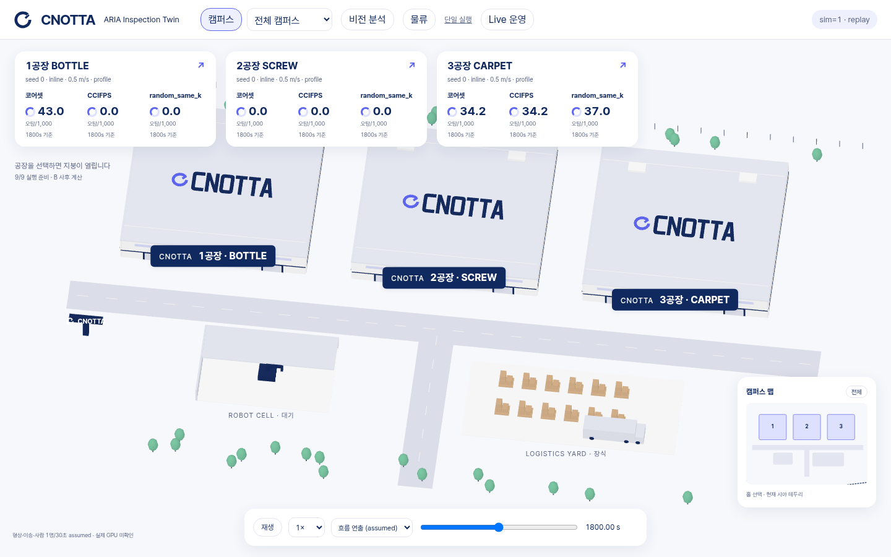
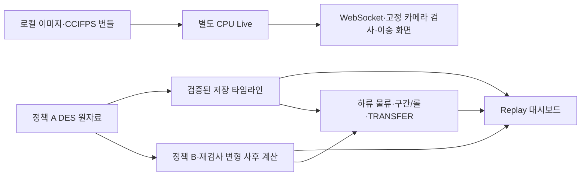
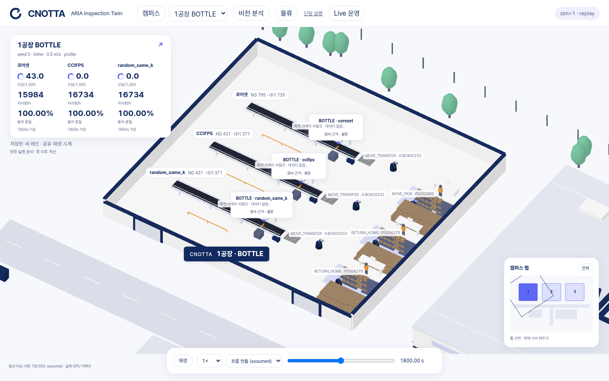
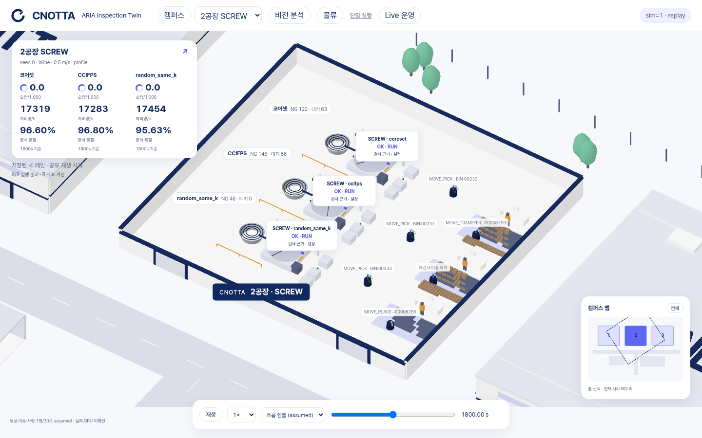
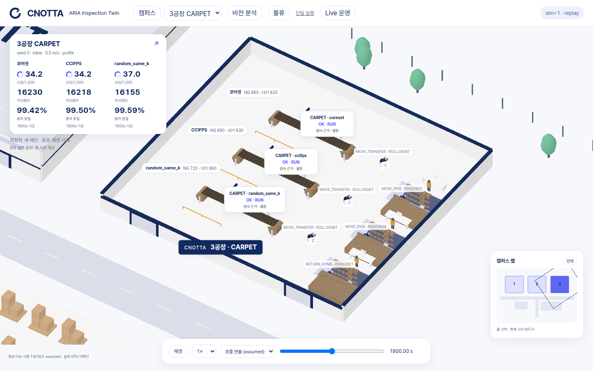
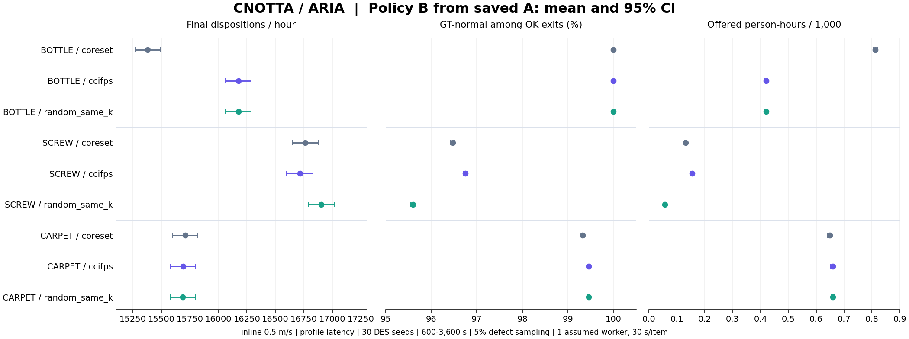

# CNOTTA × ARIA

**비전 이상 탐지 결과를 공정·검사 설비·물류 흐름으로 연결하는 디지털 트윈 연구 워크스페이스입니다.**

ARIA는 CCIFPS, 코어셋, `random_same_k`의 저장 결과를 비교하고, CNOTTA 캠퍼스에서 제품 이동·판정·재검사 대기열을 재생합니다. 별도의 CPU Live 모드에서는 실제 BOTTLE 이미지를 검사합니다. 현재 개발 브랜치는 **`dt-cnotta`**입니다.

[최신 BuildSpec](docs/specs/CNOTTA_ARIA_Autopilot_BuildSpec.md) · [구현·검증 보고서](docs/autopilot/STATIONS_REPORT.md) · [진행 기록](docs/autopilot/PROGRESS.md) · [제약·미완료 항목](docs/autopilot/BLOCKERS.md)




실제 구현 화면입니다. **seed 0, 시뮬레이션 1,800초**에서 캡처했으며, 아래 연구 표의 **30시드·600–3,600초 집계**와 관측 범위가 다릅니다. 화면 검증은 CPU SwiftShader로 수행했고 실제 GPU FPS는 측정하지 않았습니다.

[실행 방법](#대시보드-시작) · [화면 사용법](#화면으로-따라가기) · [수치 분석](#실험-결과와-수치-분석) · [문제 해결](#접속이나-재생이-안-될-때) · [검증 상태](#검증-상태)

## 현재 구성

| 영역 | 구현 내용 |
|---|---|
| 캠퍼스 | `campus.layout.json`으로 배치한 3개 공장, 홀 진입·지붕 페이드·미니맵 |
| 모델 비교 | 각 공장의 코어셋·CCIFPS·`random_same_k` 3개 레인, 총 9개 저장 실행 |
| 1공장 BOTTLE | 비전 터널, 상부 고정 카메라·링 조명, NG 푸셔, HOLD 게이트 |
| 2공장 SCREW | 볼 피더, 유리 원판 원호 경로, 상부 카메라, 에어 노즐, OK 통 |
| 3공장 CARPET | 언와인더, 라인 카메라·조명, 결함 라벨, 리와인더, 롤 등급별 적재 |
| 검사 근거 | 원본 해상도·모델·임계값, 최근 판정 10개 입력/히트맵, 지연 p50/p95 |
| 이송 로봇 | 별도 7단계 `TRANSFER`, 박스·통·롤·재검사 부품 ID 추적 |
| 하류 물류 | 저장 A/B 출구에서 포장·팔레트·지게차·트럭 계산, 제품별 화면 매핑 |
| CPU Live | BOTTLE CCIFPS 1개 레인의 실제 검사, WebSocket 상태, 순찰·고장·복구 |

카메라는 데이터셋과 같은 **수직 하향 방향**입니다. 검사는 고정 카메라가 담당하고, 로봇은 이송·적재를 담당합니다. 현재 스테이션은 코드로 만든 일반 설비 형상이며 실존 장비 제품의 외형·로고를 복제하지 않습니다. CNOTTA 로고는 교체 가능한 임시 SVG입니다.

## Replay와 Live의 차이

| | Replay | CPU Live |
|---|---|---|
| 입력 | 해시 검증된 저장 실행·예측·지연 프로파일 | 로컬 BOTTLE 이미지와 검증된 CCIFPS 모델 번들 |
| 검사 | 저장 판정과 히트맵을 재생 | 기존 검출기로 실제 CPU 추론 |
| 범위 | 3개 클래스 × 3개 모델 | BOTTLE CCIFPS 1개 레인 |
| 시간 | 저장 실행의 공유 sim 시계, 시각 이동·배속 | 별도 시연용 DES의 서버 시계 |
| 실행 방법 | 홀 선택 후 하단 **재생** | 상단 **Live 운영** → **Live 시작** |

Replay의 3D 장면은 저장 결과의 시각화입니다. Live는 연구 본 실행과 분리된 시연이며, 연구 결과를 생성하거나 수정하지 않습니다. 모델과 입력이 준비되지 않은 검사를 가짜 OK/NG로 대체하지 않습니다.



## 실행 준비

검증 환경은 **Python 3.10, Node.js 20, Linux**입니다. Python 의존성이 준비된 격리 환경과 프런트엔드 로컬 의존성을 사용합니다. [requirements.txt](requirements.txt)는 연구·기존 Factory 기능까지 포함하고 `faiss-gpu` 등 환경별 설치가 필요한 항목이 있으므로, 모든 OS에서 동일하게 설치되는 잠금 파일은 아닙니다.

**Git 클론에는 연구 원자료·데이터셋·모델 가중치가 포함되지 않습니다.** 새 클론에서 데이터가 있는 화면을 실행하려면 아래 자산을 별도로 준비해야 합니다.

| 자산 | 연결 위치 / 설정 |
|---|---|
| 검증된 파일럿 A 실행 | `CNOTTA_PILOT` → `runs/*/complete.json`과 원자료가 있는 폴더 |
| P1 예측·GT·저장 히트맵 | `CNOTTA_P1` → 클래스별 `complete.json`, 모델별 예측·맵 |
| 본 실험 결과 | `CNOTTA_RESULTS` → 실행 폴더·완료/검증 마커·집계·REPORT |
| 데이터셋 이미지 | 저장소의 `data/bottle`, `data/screw`, `data/carpet` |
| Live 모델 | `banks/ccifps/<run_id>/`의 완료 번들과 manifest가 참조하는 가중치 |

Live의 모델 ID는 [configs/live_ops.json](configs/live_ops.json)에 있습니다. 번들의 bank·가중치 해시와 경로가 맞아야 합니다. Live 입력 순서는 시연용이며 연구의 불량률 5% 재샘플링과 구분합니다. 기존 작업 환경의 데이터 기본 경로는 [scripts/demo.sh](scripts/demo.sh)에서 확인할 수 있습니다.

## 대시보드 시작

### 1. 환경과 입력을 준비합니다

아래는 **연구 의존성이 설치된 `aria` 격리 환경**을 사용하는 경로입니다. `conda activate aria`는 환경을 새로 만드는 명령이 아닙니다. 새 PC에서는 먼저 해당 환경과 위 표의 데이터를 준비해야 하며, 현재 저장소는 데이터·모델까지 자동 내려받는 설치 패키지를 제공하지 않습니다. `requirements.txt`의 GPU 의존성 때문에 CPU 전용 새 환경에 일괄 설치가 성공한다고 가정하지 않습니다.

이미 이 프로젝트의 데이터와 `frontend/node_modules`가 준비된 작업 환경이면 클론·`npm ci`를 반복할 필요가 없습니다. 새 클론은 기본 `main`을 사용하고, 소스 개발은 `dt-cnotta`에서 진행합니다.

```bash
git clone https://github.com/JUNGSEHOON-AutoML/Aria-virual-industrial.git
cd Aria-virual-industrial

# 프로젝트 Python 의존성이 준비된 격리 환경을 활성화합니다.
conda activate aria

# 새 체크아웃에서 프런트엔드 의존성 준비
cd frontend
npm ci
cd ..

export CNOTTA_PYTHON="$(command -v python)"
export CNOTTA_NODE="$(command -v node)"
export CNOTTA_PILOT=/absolute/path/to/des_pilot30
export CNOTTA_P1=/absolute/path/to/p1_verified
export CNOTTA_RESULTS=/absolute/path/to/completed_policy_a_results

# Python API import와 Node 버전 확인
"$CNOTTA_PYTHON" -c "import aria.dashboard.server; print('API import OK')"
"$CNOTTA_NODE" --version  # v20 이상

# 두 서버를 실행합니다. Ready 메시지가 나올 때까지 기다립니다.
bash scripts/demo.sh
```

### 2. 브라우저에서 엽니다

- 대시보드: [http://127.0.0.1:5278/cnotta.html](http://127.0.0.1:5278/cnotta.html)
- Live: [http://127.0.0.1:5278/cnotta.html?mode=live](http://127.0.0.1:5278/cnotta.html?mode=live)
- API 문서: [http://127.0.0.1:5277/docs](http://127.0.0.1:5277/docs)

GitHub 저장소 주소는 소스와 문서를 보는 주소입니다. 대시보드는 위 명령으로 실행한 서버에 접속해야 합니다. `127.0.0.1`은 브라우저가 실행되는 PC를 가리키므로 원격 서버를 쓰면 아래 SSH 전달이 필요합니다.

스크립트는 `CUDA_VISIBLE_DEVICES=''`로 CPU 실행을 고정하고, API와 웹 서버를 loopback에만 띄웁니다. 사용 중인 포트는 실행을 거절하며, Ctrl+C는 이 스크립트가 시작한 두 서버만 정리합니다. 서버를 원격 머신에서 실행했다면 웹 포트를 전달하세요.

```bash
# 로컬 PC에서 실행: 웹과 API 문서를 모두 전달
ssh -L 5278:127.0.0.1:5278 -L 5277:127.0.0.1:5277 <user>@<server>

# 다른 포트로 실행하려면 서버에서
CNOTTA_API_PORT=5287 CNOTTA_WEB_PORT=5288 bash scripts/demo.sh
```

원기록 최초 해시 검증·로딩은 60초 이상 걸릴 수 있습니다. **홀 선택 → 재생 → 스테이션 HMI** 순서로 이동하면 판정과 검사 근거를 볼 수 있습니다. Live는 **Live 시작**을 눌러야 시간이 진행됩니다. CPU 추론 중에는 해당 검사 상태를 유지합니다. `bash scripts/demo.sh --check`는 기동·페이지·API를 점검한 뒤 자신이 시작한 서버를 종료합니다.

## 화면으로 따라가기

### 3. Replay에서 제품과 설비를 움직입니다

1. 캠퍼스에 **9/9 실행 준비**가 나타나는지 확인합니다. 이는 실행 목록 준비 상태이며 원자료·KPI 검증은 조금 더 걸릴 수 있습니다.
2. `1공장 BOTTLE`, `2공장 SCREW`, `3공장 CARPET` 중 하나를 클릭합니다. 지붕이 열리면서 모델별 세 레인이 보입니다.
3. 하단 **재생**을 누릅니다. 제품 이동·배출기·벨트·이송 로봇은 저장 시각에 따라 움직입니다. 이벤트가 없는 구간에서는 설비가 정지할 수 있습니다.
4. 배속과 시간 슬라이더로 같은 시점의 레인을 비교합니다. **일시정지**하면 제품·이송도 함께 정지합니다.
5. 레인의 **검사 근거·설정(HMI)**을 열면 원본/히트맵·임계값·최근 판정·지연 p50/p95를 확인할 수 있습니다. 상단 **비전 분석**은 클래스별 점수·오탐·미탐 분석입니다.
6. **물류**를 누르면 하류 포장·이송 정보를 확인합니다. BOTTLE은 박스·팔레트·트럭, SCREW는 OK 통, CARPET은 구간·롤 등급으로 표현합니다. 외곽 물류 야드는 장식입니다.

**BOTTLE — 고정 카메라 검사와 박스·재검사 이송**



상부 비전 터널에서 판정한 뒤 OK/NG/HOLD로 분기합니다. 로봇은 `TRANSFER` 작업으로 박스 또는 재검사 물체를 옮깁니다. 측면 카메라는 대응 데이터가 없어 비활성 상태로 표시합니다.

**SCREW — 볼 피더·유리 원판·상부 카메라·OK 통**



모델별 NG 수와 재검사 대기열을 함께 비교합니다. NG가 적다는 사실만으로 탐지가 좋다고 판단할 수 없습니다. 아래 분석에서 SCREW의 높은 미탐 비율을 별도로 설명합니다.

**CARPET — 원단 구간·결함 라벨·롤 등급**



이미지 1개를 원단 구간 1개로 매핑하고, 정시에 부착된 NG 라벨 수로 롤 등급을 계산합니다. GT는 등급 제어에 들어가지 않습니다. 구간 길이와 롤 용량, 등급 기준은 측정된 공장 규격이 아닌 `assumed` 설정입니다.

네 캡처는 동일한 `t=1800s`의 실제 화면이며 모든 KPI가 해당 시각으로 갱신된 뒤 저장했습니다. 공개 캡처에는 데이터셋 입력/히트맵 갤러리나 제3자 참고 영상 프레임이 들어 있지 않습니다. [이미지 출처·SHA-256](docs/reports/readme_20261013/images.json)

### 4. CPU Live를 시작합니다

상단 **Live 운영 → Live 시작**을 누릅니다. 이 모드는 저장 영상을 반복하는 대신 로컬 **BOTTLE CCIFPS** 모델로 실제 CPU 추론하고 WebSocket으로 상태를 받습니다. CPU 추론 중에는 검사 상태가 유지될 수 있습니다. 공정이 움직이더라도 이는 가상 설비이며 실장비에 제어 명령을 보내지 않습니다.

Live의 판정 근거는 해당 물체/HMI에서 확인하고, 정지할 때는 **일시정지**를 누릅니다. **Replay 보기**로 돌아가면 Live는 일시정지됩니다. SCREW와 CARPET의 실시간 추론은 아직 연결하지 않았으며 해당 화면은 저장 Replay로 봅니다. 모델 번들/가중치가 없으면 `SKIPPED` 등 실패 이유를 표시하므로 모델 준비 상태부터 확인합니다.

### 접속이나 재생이 안 될 때

| 증상 | 확인과 해결 |
|---|---|
| “이 사이트에 연결할 수 없습니다” | 실행 터미널의 `Ready:` 주소와 접속 포트를 맞춥니다. 터미널 종료 시 서버도 종료됩니다. 원격 실행이면 SSH 터널을 유지합니다. |
| `Address already in use` | 다른 서버를 종료하지 말고 `CNOTTA_API_PORT=5287 CNOTTA_WEB_PORT=5288 bash scripts/demo.sh`로 실행합니다. 브라우저도 5288로 바꾸고 원격 터널도 같은 포트로 맞춥니다. |
| `CNOTTA_PILOT/CNOTTA_P1에 검증된 데이터 경로가 필요합니다` | `CNOTTA_PILOT/runs`와 P1 폴더를 확인합니다. Git 클론에는 이 데이터가 없습니다. |
| 일부 레인이 `완료 대기` | 클래스·모델·조건이 맞는 완료 결과가 필요합니다. 9개 레인에는 본 실험 결과를 연결합니다. 빈 폴더나 미완료 결과를 완료로 표시하지 않습니다. |
| `검증·로딩 중`, 첫 화면이 오래 멈춤 | 해시 검사와 타임라인 순차 로딩을 기다립니다. `Ready`는 최초 대표 실행 점검이고 9개 레인의 모든 로딩 완료를 뜻하지 않습니다. |
| 화면은 보이지만 안 움직임 | Replay는 하단 **재생**, Live는 **Live 시작**을 누릅니다. 3,600초 끝 지점이면 Replay 시간을 앞쪽으로 이동합니다. |
| `409` 또는 해시 불일치 | 동일 실행에 사용된 P1·예측·완료 마커를 연결합니다. 검증 코드를 끄거나 원자료를 덮어쓰지 않습니다. |
| Live `SKIPPED`·검사 실패 | BOTTLE 이미지, `configs/live_ops.json`의 모델 ID, 완료 번들 및 manifest가 가리키는 파일·해시를 점검합니다. |

기본 로그는 `docs/autopilot/local/demo/api.log`, `web.log`입니다. `CNOTTA_LOG_DIR`로 위치를 바꿀 수 있습니다. 실행 상태는 아래처럼 읽기 전용으로 점검할 수 있습니다.

```bash
# 대시보드가 실행 중인 서버에서 확인
curl --fail http://127.0.0.1:5278/cnotta.html -o /dev/null
curl --fail http://127.0.0.1:5277/api/dt/campus

# 서버를 끈 뒤 별도 기동 검사를 할 때만 사용; 완료 후 자동 종료
bash scripts/demo.sh --check
```

## 연구 계산 계약

- DES는 **정책 A만 실행**하고 정책 B와 재검사 변형은 저장된 A에서 사후 계산합니다.
- 계획은 기준 A 2,700회 + 상한 확인 270회 = **2,970회**입니다. 기존 유효 A 15회를 재사용하므로 신규 실행은 **2,955회**입니다.
- B 기본 2,700건 + 단일 요인 변형 1,620건 = **사후 계산 4,320건**입니다.
- 소스는 불량률 5% 확률로 복원추출하며, 관측 불량률을 강제로 5%에 맞추지 않습니다.
- 재검사 부하·오탐·인시는 워밍업 이후 본 라인 출구 전체를 분모로 **1,000개당 정규화**합니다.
- GT는 소스 준비·평가·재검사 oracle에서 사용하며 화면의 AI 판정이나 롤 등급에 피드백하지 않습니다.

본 실험의 완료/검증 마커는 확인됐고, **M5의 실데이터 UI 게이트 재검증은 남아 있습니다.** 완료 원자료는 Git에 포함되지 않습니다. 이번 문서에는 대표 조건의 수치를 표와 그래프로 공개했습니다. 전체 집계 CSV·원 결과 REPORT 사본은 로컬에 보존합니다. 계산 계약과 재현 경로는 [재설정 명세](docs/specs/ARIA_DT_Reset_BuildSpec_v3.md), [재설정 보고서](docs/DT_RESET_REPORT.md), [최신 진행 기록](docs/autopilot/PROGRESS.md)을 참고하세요. 초기 보고서의 “실행 대기”는 작성 당시 상태입니다.

CARPET의 이미지 1장은 원단 구간으로 매핑하고, 롤 등급은 제때 부착된 NG 라벨 수로 정합니다. 무라벨 결함·미탐은 별도 사후 평가 항목입니다. 구간 길이·롤 크기·등급 기준·물류 속도·이송 자세와 시간은 **`assumed`** 설정입니다. 물류와 TRANSFER의 대기는 원본 DES/B 시각·처리량을 변경하지 않습니다.

## 실험 결과와 수치 분석

### 실험 규모와 비교 조건

| 구분 | 구성 | 완료 수 |
|---|---|---:|
| 기준 정책 A | 3클래스 × 3모델 × 5공정 조건 × 2지연 모드 × 30시드 | 2,700 |
| 상한 확인 A | 3클래스 × 3모델 × 30시드, inline 2m/s·profile | 270 |
| 정책 A 합계 | 신규 2,955 + 기존 유효 실행 15 재사용 | **2,970** |
| 기본 B 사후 계산 | 기준 A 각각의 오프라인 재검사 | 2,700 |
| B 단일 요인 변형 | 대표 조건 × 6변형 × 3클래스 × 3모델 × 30시드 | 1,620 |
| 정책 B 합계 | 신규 DES 실행 0 | **4,320** |

5공정 조건은 `robot 0.5m/s`, `inline 0.25/0.5/0.75/1.0m/s`입니다. 지연 모드는 저장 지연 프로파일을 사용하는 `profile`과 고정 지연인 `constant`입니다. 상한 2m/s는 별도 가정 조건입니다. 본 단계 기록 시간은 **6.033시간**이며, 별도 상한 seed 0 실측 **166.90초**는 이 시간에 포함되지 않습니다. 장비가 달라지면 같은 소요 시간을 보장하지 않습니다.

아래 공정 비교는 **inline 0.5m/s, profile, 워밍업 600초, 종료 3,600초, seed 0–29**로 고정했습니다. 입력은 불량 확률 5%로 복원추출합니다. B는 사람 1명·건당 30초·민감도/특이도 1.0의 `assumed` 재검사이며 NG만 재검사합니다. 원래 OK로 통과한 미탐은 재검사하지 않습니다.

[문서 수치 대조·검증 기록](docs/autopilot/gates/readme_detail.json). 전체 집계 CSV와 원 결과 보고서는 로컬 연구 자료로 보존하며, 이 공개 README에는 위 대표 조건을 요약합니다.

### 1. 고정 이미지 집합의 탐지 성능

다음은 L1 리포트의 **서로 다른 이미지**에 대한 결과입니다. BOTTLE 83장(불량 63·정상 20), SCREW 160장(불량 119·정상 41), CARPET 117장(불량 89·정상 28)을 사용합니다. 이 표의 불량 구성은 공정 시뮬레이션의 5% 불량률과 다릅니다. 임계값은 정상 holdout 점수의 `평균 + 3 × 모집단 표준편차`이며 `score > threshold`를 NG로 판정합니다.

<!-- README_TABLE:detection -->
| 클래스 | 모델 | TP | FN | FP | TN | 결함 재현율 | 정상 오탐률 |
|---|---|---:|---:|---:|---:|---:|---:|
| BOTTLE | coreset | 63 | 0 | 1 | 19 | 100.00% | 5.00% |
| BOTTLE | ccifps | 63 | 0 | 0 | 20 | 100.00% | 0.00% |
| BOTTLE | random_same_k | 63 | 0 | 0 | 20 | 100.00% | 0.00% |
| SCREW | coreset | 37 | 82 | 0 | 41 | 31.09% | 0.00% |
| SCREW | ccifps | 44 | 75 | 0 | 41 | 36.97% | 0.00% |
| SCREW | random_same_k | 16 | 103 | 0 | 41 | 13.45% | 0.00% |
| CARPET | coreset | 78 | 11 | 1 | 27 | 87.64% | 3.57% |
| CARPET | ccifps | 80 | 9 | 1 | 27 | 89.89% | 3.57% |
| CARPET | random_same_k | 80 | 9 | 1 | 27 | 89.89% | 3.57% |
<!-- /README_TABLE:detection -->

`TP`=불량 검출, `FN`=불량 미탐, `FP`=정상 오탐, `TN`=정상 통과입니다. **결함 재현율 = TP/(TP+FN)**, **정상 오탐률 = FP/(FP+TN)**입니다. 아래의 `오탐/1,000`은 분모가 전체 본 라인 출구이므로 이 정상 오탐률과 구분해야 합니다.

BOTTLE에서는 CCIFPS와 random_same_k 모두 이 표의 오탐·미탐이 0입니다. 정상 이미지가 20장이므로 오탐 1건이 정상 오탐률 5%p에 해당하며, 이 작은 고정 표본의 차이를 실제 생산 환경의 확정 성능으로 확대하면 안 됩니다. **BOTTLE에서 CCIFPS가 random_same_k보다 우수하다는 결론은 이 결과로 낼 수 없습니다.** SCREW는 CCIFPS가 코어셋보다 불량 7개를 더 검출하지만 119개 중 75개를 놓칩니다. 재현율 36.97%이므로 여전히 개선이 필요한 클래스입니다. CARPET은 CCIFPS와 random_same_k의 혼동행렬이 같고 코어셋보다 미탐이 2개 적습니다.

출처: [BOTTLE](docs/reports/vision_audit/bottle/report.json), [SCREW](docs/reports/vision_audit/screw/report.json), [CARPET](docs/reports/vision_audit/carpet/report.json). 원본 이미지·히트맵은 로컬에만 있습니다.

### 2. 판정 결과가 공정에 미치는 영향



점은 30시드 평균, 선은 95% 신뢰구간입니다. 첫 두 패널은 작은 차이를 읽기 위해 가로축을 0에서 시작하지 않았으므로 절대 차이는 아래 표와 함께 보세요.

<!-- README_TABLE:process -->
| 클래스 | 모델 | 본 라인 출구/h | B 최종 처분/h [95% CI] | OK 출구 품질 | 오탐/1,000 | 인시/1,000 |
|---|---|---:|---:|---:|---:|---:|
| BOTTLE | coreset | 16,906.80 | 15,380.92 [15,273.08, 15,488.76] | 100.000% | 46.97 | 0.8113 |
| BOTTLE | ccifps | 16,906.84 | 16,175.00 [16,061.38, 16,288.62] | 100.000% | 0.00 | 0.4199 |
| BOTTLE | random_same_k | 16,906.88 | 16,175.04 [16,061.48, 16,288.60] | 100.000% | 0.00 | 0.4199 |
| SCREW | coreset | 16,907.00 | 16,761.60 [16,646.55, 16,876.65] | 96.475% | 0.00 | 0.1308 |
| SCREW | ccifps | 16,907.00 | 16,714.08 [16,599.31, 16,828.85] | 96.751% | 0.00 | 0.1542 |
| SCREW | random_same_k | 16,906.92 | 16,903.56 [16,787.14, 17,019.98] | 95.604% | 0.00 | 0.0561 |
| CARPET | coreset | 16,906.76 | 15,709.84 [15,599.30, 15,820.38] | 99.320% | 33.80 | 0.6491 |
| CARPET | ccifps | 16,906.68 | 15,689.12 [15,578.58, 15,799.66] | 99.451% | 33.80 | 0.6593 |
| CARPET | random_same_k | 16,906.60 | 15,688.12 [15,579.51, 15,796.73] | 99.452% | 33.85 | 0.6597 |
<!-- /README_TABLE:process -->

수치의 의미는 [평가기](aria/simulation/dt/evaluation.py)와 [B 사후 계산](aria/simulation/dt/posthoc.py)에 맞췄습니다.

| 지표 | 정의와 해석 |
|---|---|
| 본 라인 출구/h | 관측 창의 본 라인 출구 수 ÷ 관측 시간. B의 오프라인 대기열이 이 값을 늦추지 않습니다. |
| B 최종 처분/h | 관측 창에 최종 `exit_time`을 가진 OK·NG·HOLD 전체 수 ÷ 관측 시간. **양품 출하량이 아니며**, 재검사 대기 중인 물체는 제외합니다. |
| OK 출구 품질 | 최종 OK 출구 중 GT 정상 비율. 화면의 “출하 품질”이 뜻하는 값이며, 물류 트럭의 실제 출하 품질과는 별개입니다. |
| 오탐/1,000 | 본 라인 출구 코호트의 FP ÷ 전체 본 라인 출구 × 1,000. 분모에 HOLD도 포함합니다. |
| 인시/1,000 | 본 라인 출구 코호트의 NG ÷ 전체 출구 × 1,000 × 재검사 서비스 초 ÷ 3,600. **유입된 총 재검사 업무량**이며 실제 투입 인원의 완료 작업시간이 아닙니다. |

본 라인은 모든 조합에서 약 16,907개/h인데, B 최종 처분량은 더 작습니다. 이는 오프라인 재검사가 관측 종료 시점까지 일부 NG를 처리하지 못하기 때문입니다. 이 차이를 본 라인이 막혔다거나 제품이 사라졌다고 해석하면 안 됩니다.

### 3. 같은 seed의 CCIFPS − coreset 차이

두 모델의 독립 구간을 비교하는 대신 같은 seed끼리 차이를 낸 **대응 비교**입니다. `%p`는 백분율 포인트입니다.

<!-- README_TABLE:paired -->
| 클래스 | 최종 처분/h 차이 [95% CI] | OK 출구 품질 차이, %p [95% CI] | 인시/1,000 차이 [95% CI] |
|---|---:|---:|---:|
| BOTTLE | +794.08 [+781.09, +807.07] | +0.000 [+0.000, +0.000] | -0.3914 [-0.3970, -0.3857] |
| SCREW | -47.52 [-50.69, -44.35] | +0.276 [+0.258, +0.295] | +0.0234 [+0.0219, +0.0250] |
| CARPET | -20.72 [-22.44, -19.00] | +0.132 [+0.121, +0.142] | +0.0102 [+0.0094, +0.0110] |
<!-- /README_TABLE:paired -->

- **BOTTLE:** 최종 처분량은 **+794.08개/h(코어셋 평균 대비 약 +5.16%)**, 재검사 업무량은 **약 48.24% 감소**합니다. 두 모델 모두 이 이미지 집합의 미탐은 0이므로 주요 차이는 정상 오탐 감소입니다. 다만 random_same_k도 같은 오탐·미탐 수를 보였습니다.
- **SCREW:** CCIFPS가 더 많은 불량을 NG로 보내면서 OK 출구 품질은 **+0.276%p** 개선되지만, 한 명의 재검사 큐로 더 많은 일이 들어와 최종 처분량은 **47.52개/h 감소**하고 인시는 증가합니다. random_same_k의 높은 처분량·낮은 재검사 부담은 미탐이 많다는 사실과 함께 봐야 합니다.
- **CARPET:** CCIFPS는 코어셋보다 OK 출구 품질이 **+0.132%p** 높고 미탐이 적지만, 오탐 부담은 거의 같으며 인시가 조금 증가합니다. 이 조건에서 CCIFPS와 random_same_k의 근접한 결과만으로 광범위한 우위를 주장하지 않습니다.

출처: 로컬 완료 실험의 `summary_ci95.csv`와 `paired_effects.csv`를 대조했습니다. [대조 기록](docs/autopilot/gates/readme_detail.json) CI는 **고정 이미지·고정 뱅크에 대한 DES 시드 변동**입니다. 독립 학습 30회, 새로운 데이터셋·공장에 대한 일반화 신뢰구간 또는 여러 조건에 대한 다중비교 보정 결과를 뜻하지 않습니다.

### 4. 재검사 시간을 바꾸면

BOTTLE CCIFPS의 동일한 A 원자료에서 서비스 시간만 바꾼 사후 계산입니다. 사람은 계속 1명이고 민감도·특이도도 1.0으로 유지합니다. 표는 각 30시드 평균입니다.

<!-- README_TABLE:sensitivity -->
| 재검사 서비스 시간 (assumed) | B 최종 처분/h | 인시/1,000 | 시간 평균 재검사 대기열 |
|---|---:|---:|---:|
| 10초 | 16,415.00 | 0.1400 | 283.11개 |
| 30초 | 16,175.00 | 0.4199 | 422.56개 |
| 60초 | 16,115.00 | 0.8398 | 457.48개 |
<!-- /README_TABLE:sensitivity -->

10초로 줄여도 평균 대기열이 **283.11개**이므로 이 가정에서 1명으로 충분하다고 말할 수 없습니다. 30초 조건의 `ρ<1` 유입 부하 기준 필요 인원은 seed별 정수 추정의 평균 **7.70명**입니다. 이는 7.7명으로 운영하라는 권고가 아니며 대기시간 보장이나 실제 인력 산정 결과도 아닙니다. 비용 비교에는 미완료 잔량·미탐·폐기·사람의 정확도 가정을 함께 포함해야 합니다.

### 수치 검증과 원자료 범위

이번 문서 작성에서는 집계 **5,589행**과 대응 차이 **1,863행**, 총 **7,452행**의 평균·95% CI를 seed별 결과 CSV로 다시 대조했습니다. 여기에는 원자료의 공개가 포함되지 않습니다. 전체 CSV·원 결과 보고서·재현 도구는 로컬 커밋에 보존하고, README에는 위 대표 조건의 표와 그래프만 게시합니다.

원 결과에 접근할 수 있다면 `summary_ci95.csv`에서 `scope=main`, `cell=inline`, `speed=0.5`, `latency_mode=profile`, `policy=B`를 선택하면 공정 표의 값이 나옵니다. 대응 비교는 `paired_effects.csv`의 같은 조건입니다. 재검사 시간 표는 BOTTLE CCIFPS의 서비스 시간 10/30/60초만 비교하고 민감도·특이도는 1.0으로 고정합니다. 계산 정의는 [집계 도구](tools/summarize_policy_a.py)에서 확인할 수 있습니다.

원시 이벤트의 전체 해시 검사는 기존 완료 검증 기록을 인용하며 이번에 반복하지 않았습니다. 본 실험 완료와 **M5 실데이터 UI 게이트 재검증 완료**는 별개이고, M5 후자는 아직 남아 있습니다.

## 검증 상태

S1–S3 및 L2 역할 재검증 시점(`f8da8c9`, 2026-10-13)의 결과입니다.

| 검증 | 결과 |
|---|---|
| 백엔드 전체 | **223 passed, 3 skipped** |
| 골든 트레이스 | **diff 0** |
| 기존 DES·평가기·robot.py·기존 테스트 | S1–S3 변경 없음 |
| 검사 카메라 9대 | 하향 각도 오차 0°, 트리거 제품 전체가 frustum 안 |
| SCREW / CARPET | 저장 경로 겹침 0, 구간 보존·라벨 기반 등급 일치 |
| TRANSFER | 출처 이벤트 = 작업 **15,469건**, 물체 ID 일치 |
| 그리퍼 | OPEN 중 고정 물체 이동 0m, CLOSED 시 TCP 차이 0m |
| 웹 | CPU 빌드 성공, 브라우저 JS/HTTP 오류 0, 최대 183 draw calls |
| 실제 CPU Live | 실제 NG 검사·원본/히트맵·일시정지 확인 |

[상세 보고서](docs/autopilot/STATIONS_REPORT.md) · [S1 게이트](docs/autopilot/gates/s1.json) · [S2 게이트](docs/autopilot/gates/s2.json) · [S3 게이트](docs/autopilot/gates/s3.json) · [L2 재검증](docs/autopilot/gates/l2-stations.json)

```bash
# 준비된 격리 Python 환경, 저장소 루트에서
CUDA_VISIBLE_DEVICES='' OPENBLAS_NUM_THREADS=1 OMP_NUM_THREADS=1 python -m pytest tests -q
CUDA_VISIBLE_DEVICES='' python tests/golden_trace.py --verify
node tools/gates/stations_test.mjs

# CNOTTA 웹 빌드: 기존 Factory의 npm run build와 별도 설정
cd frontend
node node_modules/vite/bin/vite.js build --config vite.cnotta.config.js
```

원자료 기반 테스트에는 검증된 데이터가 필요하고, PostgreSQL 통합 테스트에는 `ARIA_TEST_POSTGRES_DSN`이 필요합니다. CPU 브라우저 게이트의 URL·실행 순서는 [스테이션 보고서](docs/autopilot/STATIONS_REPORT.md)를 따릅니다. 문서만 변경한 커밋에서 과거 테스트를 재실행한 것으로 표시하지 않습니다.

## 구조

```text
aria/dashboard/          Replay·CPU Live API, 물류·스테이션·TRANSFER
aria/simulation/des/     기존 DES·로봇 FK·검사·순찰·복구
aria/simulation/dt/      연구 계획·정책 B 사후 계산·평가기
aria/inspection/         기존 이상 탐지 어댑터
aria/mcp/servers/        파일·추론·공정 등 MCP 도구
frontend/src/campus/     3개 홀·카메라·Replay·물류 화면
frontend/src/stations/   제품별 설비·검사 카드·이송·롤 표현
frontend/src/live/       CPU Live 상태·입력/히트맵·순찰 UI
configs/                캠퍼스·움직임 출처·물류·스테이션 설정
docs/specs/             BuildSpec 및 추가 명세
docs/autopilot/          진행·결정·제약·검증 게이트
exports/usd/            O1 시점의 정적 OpenUSD 스냅샷
tools/                  연구 도구·CPU 검증·USD 내보내기
scripts/demo.sh         CPU 대시보드 실행
```

모든 새 움직임은 [ambient_motion.json](configs/ambient_motion.json)에 출처와 시계를 등록합니다. 임의 타이머나 난수로 판정·대기열을 만들지 않습니다. 실행 원자료·모델·토큰·내부 참고 프레임·데이터셋 갤러리 캡처는 Git에서 제외합니다. 공개용으로 확인한 자체 화면 4장과 대표 조건의 요약 그래프는 이 README에 포함합니다. 전체 집계 CSV는 로컬에 보존합니다. 대용량 연구 자료의 보존 목록은 [provenance](docs/provenance/dt-wip-20261013/external_artifacts.json)에 있습니다.

## 다음 단계와 한계

- 다음 웹 순서: **L3 → L4 → V1–V3 → M3/M4 재검증 → G3 → M5 → M6 재검증**. S1–S3와 L2 역할 재검증은 완료했습니다.
- 실제 GPU 화풍·FPS는 미확인입니다. 현재 브라우저 검증은 **SwiftShader**입니다.
- O0 환경 게이트 미달로 Omniverse O2/O3는 보류입니다. 기존 O1 USD는 S1–S3 이전 정적 장면으로, 현재 웹 설비와의 일치는 다시 검증해야 합니다. [O1 보고서](docs/autopilot/O1_REPORT.md)
- V2/V3의 추가 입력은 승인된 L1 이미지 범위와 충돌해 보류입니다. 모델 코드·가중치 라이선스를 각각 확인하기 전에는 다운로드하지 않으며 Hunyuan3D는 사용하지 않습니다.
- 로봇 운동은 가상 운동학과 assumed 작업 매핑입니다. 실장비 제어·충돌/토크 동역학·실제 공장 생산성 검증을 의미하지 않습니다.

상세 결정은 [DECISIONS](docs/autopilot/DECISIONS.md), 미완료 사유는 [BLOCKERS](docs/autopilot/BLOCKERS.md)에 기록합니다.

## 기존 Factory와 자료

기존 공정 편집기·CAD·순찰 기능은 보존되어 있습니다. 준비된 환경에서 `frontend`의 `npm run build` 후 저장소 루트에서 `python -m uvicorn server.app:app --host 127.0.0.1 --port 8230`으로 실행하며, 현재 CNOTTA 데모와 별도 진입점입니다.

[공정 시뮬레이터](docs/INDUSTRIAL_V1_REPORT.md) · [순찰·보고](docs/PATROL_AGENT_REPORT.md) · [기존 로봇 검사 하네스](docs/ROBOT_INSPECTION_HARNESS.md) · [FreeCAD](docs/FREECAD_INTEGRATION.md) · [이전 README 기록](https://github.com/JUNGSEHOON-AutoML/Aria-virual-industrial/blob/f8da8c9/README.md)

데이터셋·모델 가중치·폰트·HDR·로봇 자산의 라이선스는 각각의 원본 조건과 저장소 내 출처 기록을 따릅니다. 기존 MVTec 이미지가 포함된 역사 자료의 출처·이용 조건은 이전 README 및 해당 보고서에 보존했습니다. 제3자 참고 영상 프레임은 내부 참고용이며 공개 저장소에 포함하지 않습니다.
