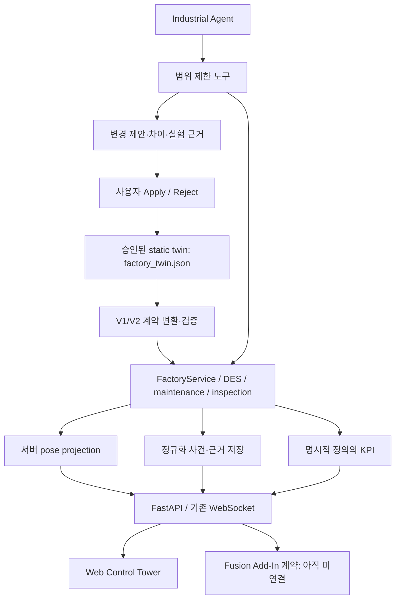

# ARIA V2 구조 감사 및 제안

작성: 2026-10-07 (Asia/Seoul). 상태: **구현 전 설계 문서**.

대상: `/userHome/userhome4/sehoon/Aria-virual-industrial-main`.
기준 HEAD: `0b68a3b38fbaa27c54135313490e55730cb48d16`.
감사 시작 시 git status: `?? data`. 데이터 링크 및 기존 실행 결과 보존.
요구사항: 사용자가 첨부한 「ARIA V2 — Agentic Industrial Digital Twin Control Tower」.

## A. 현재 구현에서 확인한 것

저장소 파일 목록을 확인하고 README, AGENTS, V1 명세, frontend package, factory UI·DES·API·MCP·관련 테스트의 구현 경로를 조사했다. 전체 저장소의 모든 기능을 실행 검증했다는 뜻은 아니다. 이 문서는 이번 조사와 기존 문서의 과거 성과를 분리한다.

| 실제 경로 | 확인한 동작 | 경계/부족한 점 |
|---|---|---|
| `aria/simulation/des/model.py` | Pydantic, m/s/rad, 7개 kind, DAG, 최대100 컴포넌트·2000 슬롯 | 독립 Sensor/Robot kind 없음. robot_model은 Machine/Inspection 속성. dimensions·frame 명세 불완전 |
| `aria/simulation/des/engine.py` | heap DES, seed RNG, 유한 capacity, blocking/starvation, 고장·잔여 작업 복귀, 검사 결과별 분기 | snapshot은 entered/due와 robot 상태를 주고 일반 제품의 world pose는 제공하지 않음 |
| `aria/simulation/des/service.py` | 단일 소유자·RLock, proposal/revision, 승인 후 reset·원자적 저장·실패 rollback | 저장은 `outputs/factory/factory.json`; 새 canonical config와 이중 쓰기 금지 |
| `aria/simulation/des/inspection.py`, `evidence.py` | 실검사 adapter, 모델 캐시, score/threshold, 원본 hash·heatmap 근거 | 입력 미준비/실패는 SKIPPED. 고정 이미지 목록 재생이며 실카메라 연결 증거 아님 |
| `aria/simulation/des/patrol.py`, `maintenance.py` | A* 순찰·사건 보고, 가상 센서 진단·수리·검증·인터록 | wall/control time과 DES time을 함께 사용. 단일 시간축으로 조용히 바꾸면 동작 달라짐 |
| `aria/simulation/des/robot.py`, `aria/robot/` | M0609 관절/FK·7단계 작업 확인 | 실제 제조사 제어·접촉·토크·충돌 동역학 검증 아님 |
| `server/routers/factory.py` | `/api/factory`, 약 .15초 simulation loop, state/patrol/agent 이벤트 | 에이전트가 service.lock 안에서 실험·local model 호출. 조회/운전 지연 가능성, 실측 필요 |
| `aria/simulation/des/agent.py` | 규칙 기반 intent+local Ollama 계획, 측정 도구 응답, bounded sweep·proposal | 임의 원인 진단/OEE 감소/로봇 interlock 전용 도구는 아직 부족. trace 방송은 실행 후 순차 전송 |
| `aria/mcp/servers/factory_mcp.py`, `mcp_config.json` | API 경유 factory 도구, Apply/Reject 제외, cad MCP 등록 | 별도 MCP DES 인스턴스 생성 금지 유지 |
| `frontend/src/hmi/AppShell.jsx` | Factory 기본 진입, 기존 QC 전환 | Overview 중심 제품 내비게이션 아님 |
| `frontend/src/hmi/factory/FactoryWorkspace.jsx` | 편집 palette·속성·승인·실험·채팅·workbench 조합 | 전체 store 구독, 사용자 업무 경계와 데이터 구독 경계 혼합 |
| `frontend/src/hmi/factory/factoryStore.js` | snapshot·selection·messages·experiment·proposal 단일 Zustand, WS fanout+5초 REST | 재연결/순서 역전·stale 정책 명시 부족. 전체 모델이 매 snapshot에 실림 |
| `frontend/src/hmi/factory/FactoryScene.jsx` | R3F, 제품 instancing, frame 보간 | 제품 좌표를 frontend에서 계산, connector conveyor 형상 자동 합성, conveyor running=false |
| `frontend/src/hmi/factory/IndustrialEquipment.jsx` | 설비·바닥·펜스 procedural 모델 | 크기·robot base·장식 구조 일부 하드코딩, 공통 자산 계약 필요 |
| `frontend/src/hmi/factory/RobotArm.jsx`, `CADBody.jsx` | URDF mesh, FreeCAD mesh 표시·캐시/cleanup | primitive만 있는 앱은 아님. fallback 출처 표시 강화 |
| `frontend/src/hmi/factory/EvidenceWorkbench.jsx` | 실제 이미지/히트맵, 점수·run·최근 검사 | 별도 preview 결과와 실제 workpiece 연결 이력을 분리해야 함 |
| `aria/cad/service.py`, `server/routers/cad.py`, `aria/mcp/servers/cad_mcp.py` | FreeCAD 형상 생성·정적 검증·변경 제안 | Fusion 구현으로 대체할 이유 없음 |

README의 53/65/74개 테스트, 30seed 실험, FPS는 서로 다른 과거 범위의 기록이다. V2 검증 수치로 재명명하지 않는다. 과거 대화의 3D 미표시 상태도 현재 브랜치의 실행 상태로 단정하지 않는다.

## B–D. 보존·리팩터링·퇴역

- **보존:** DES 수치 의미·RNG·순서, CCIFPS 원 모델과 임계값, SKIPPED→HOLD, robot ACK/인터록, patrol/maintenance, proposal/revision/rollback, MCP 경계, FastAPI, 단일 WS, FreeCAD, QC Live, 기존 시험·성과·원자료.
- **리팩터링:** FactoryWorkspace 책임 분리, store 분리, runtime pose projection의 서버 이동, 정규화 event envelope, static twin serializer, engineering mode, tool evidence 반환, 장비 자산 binding.
- **즉시 삭제:** 없음.
- **이행 후 퇴역:** 기본 화면의 편집 palette와 전체 JSON 노출, V2 경로의 중복 geometry 치수, whole-store scene 구독, V2의 frontend authoritative pose 계산. QC Live의 별도 실검사 화면은 유지한다. old wrapper는 새 경로 동등성 통과 후 제거한다.

## E. 제안 구조와 소유권



`factory_twin.json`은 static definition이다. 런타임 pose/KPI/event를 파일에 계속 써 넣는 중계소가 아니다. 첨부 §14의 runtime→JSON→view 도식은 이 점에서 §1과 혼동될 수 있으므로 **static definition과 runtime stream을 별도 계약**으로 해석한다.

단일 소유자는 FactoryService다. DES, maintenance가 그 소유자의 lock/검증 경계 안에서 상태를 변경한다. 자율 수리는 허용된 가상 런타임 조치이며 engineering 모델 영구 변경과 구분한다. 에이전트·웹·Fusion은 자체 생산 카운터·분류 결과·고장 복구를 결정하지 않는다.

### 상태/시간 계약

- Static: schema version, asset ID, pose/dimensions, process/routing, detector binding, interlock metadata.
- Runtime: run_id(기존 run_token 매핑), revision, snapshot_sequence, simulation_time_s, control_elapsed_s, component/part/sensor/robot 상태, pose.
- Telemetry: 값·단위·범위·계산 버전·기간·source. 누락은 null/미확인; UI formatter로 0을 만들지 않는다.
- Reasoning: claim과 tool_call_id/evidence_ref/실험 scope. 관찰·시뮬레이션 결과·가설·제안·승인 분리.
- Pause 시 DES 시간 정지, 기존 순찰의 별도 제어 시간 정책 보존. 유지보수 clock 의미와 UI 라벨을 명시하고 별도 사용자 명세 없이 단일 clock으로 합치지 않는다.

## F. 정보 구조

기본 Overview: 좌측 compact navigation, 상단 factory/mode/SIMULATION/connection/revision/time, 중앙 큰 3D, 우측 context inspector, 하단 event timeline. 1440×900에서는 drawer/접이식 하단으로 3D 영역 확보, 1920×1080에서는 inspector와 timeline 동시 표시.

내비게이션: Overview / Factory Twin / Operations / Quality / Assets / Experiments / Incidents / AI Agent. Engineering은 별도 mode. QC Live는 기존 실검사 workspace로 계속 접근 가능. 구현되지 않은 Live 연결·계정·공장 선택은 가짜 활성 제어를 만들지 않는다.

Headline KPI: throughput(/h), OEE V1(%), WIP(개), good output(개 및 /h), cycle time(s), active incidents(건). Yield는 `OK/(OK+NG)` 같은 분모를 명시하고 SKIPPED/UNINSPECTED를 별도 표시한다. 기존 OEE 수식·throughput의 SKIPPED 포함 여부는 소급 변경하지 않는다. delta는 같은 run/revision의 실제 이력에서만 산출한다.

Ask ARIA는 선택 자산 context와 근거·도구·실험을 가진 전용 workspace/패널이다. 추천 카드→Review→전체 diff→Apply/Reject. 수치에 근거 링크가 없으면 결론을 제한한다. 진행 중과 완료 후 trace를 구분한다.

## G. factory_twin.json 제안 스키마

**기존 m/s/rad/Y-up 의미를 canonical로 보존하는 안**이다. Engineering 표시·Fusion 요청은 mm 허용, 경계에서만 변환한다. Fusion mm→cm 큐브 검증과 충돌하지 않는다. CAD/Fusion 좌표 변환은 예를 들어 right-handed Y-up `(x,y,z)m`→Z-up `(100x,-100z,100y)cm`로 명시하고 basis test로 확정한다. mesh의 실제 up-axis/origin은 자산별 기록한다.

| 필드 | 형식·제약 |
|---|---|
| schema_version | `2.0`; 지원하지 않는 버전 거절 |
| factory | 기존 id/name 유지, metadata |
| frame | length_unit=m, time_unit=s, angle_unit=rad, handedness=right, up_axis=Y, origin |
| components | 기존 ID/kind/process/routing 의미 보존. transform, dimensions, visual_asset_id, sensor_ids, robot_ids, interlock_ids |
| conveyors | component_id, path_m, length_m, speed_m_s, ports; component와 길이/속도 이중 저장 금지 |
| workpiece_types | id, dimensions_m, visual_asset_id, inspection binding; 현재 runtime part 목록은 저장하지 않음 |
| sensors | 고유 id, parent asset, trigger zone/port, detector kind, evidence source=simulation 등 |
| vision_stations | component_id, detector mode, model/run/hash, threshold_source, image_source, evidence policy |
| robots | id, parent station, model binding, base transform, kinematic frame, task/ACK/interlock metadata |
| buffers | component_id, capacity, discipline, slot layout; 실제 queue는 runtime |
| connections | source/target/condition, 기존 DAG 제약 유지; loop 확장 범위 아님 |
| simulation | seed, duration, speed, control clock policy |
| telemetry_bindings | metric key/unit/source/scope/definition_version |
| visualization_assets | ID, uri/hash, license/provenance, bounds/origin/unit/axis, fallback 종류 |
| interlocks | id, observed signals, blocked commands, reset rule, simulation_only |

소유권 예: process capacity는 component.process가 소유하고 buffers 엔트리는 참조한다. 매 field의 단일 소유권을 schema validator가 검사한다. dimensions는 실제 자산 bounds/기존 형상에서 이행하며 알 수 없는 치수를 발명하지 않는다. 공장 크기는 이번 문서에서 새로 고르지 않는다.

축약 예시(실행 가능한 전체 공장 파일이 아님):

```json
{
  "schema_version": "2.0",
  "factory": {"id": "factory-demo-01", "name": "ARIA Demo Factory"},
  "frame": {"length_unit": "m", "time_unit": "s", "angle_unit": "rad", "up_axis": "Y", "handedness": "right"},
  "components": [{"id": "CONVEYOR-01", "kind": "Conveyor", "transform": {"position_m": [-9, 0, 0], "yaw_rad": 0}, "process": {"capacity": 3}, "visual_asset_id": "conveyor-01"}],
  "conveyors": [{"component_id": "CONVEYOR-01", "length_m": 2, "speed_m_s": 0.5}],
  "simulation": {"seed": 42, "duration_s": 600, "speed": "1"}
}
```

실제 이행은 V1→V2→V1의 공정 값·ID·seed·출력을 대조하며, 미지원 정보를 조용히 삭제하지 않는다.

## API / 이벤트 계약 (구현 전 제안)

기존 `/api/factory` endpoints와 `/ws/chat`을 유지하고 아래 계약을 추가한다.

- `GET /api/factory/twin-definition`: version/revision/hash를 가진 승인 static definition.
- `PUT /api/factory/twin-definition`: validate→proposal만. 기존 apply endpoint만 commit.
- `GET /api/factory/events?run_id=&after_sequence=&limit=`: bounded pagination, cursor gap을 명시.
- `GET /api/factory/inspections`: workpiece/asset/run별 근거 이력. preview는 별도 scope.
- snapshot V2: runtime pose·sensor·revision/sequence·metric definitions. model payload를 매 tick 재전송하지 않도록 참조/hash 사용. V1 소비자를 위한 adapter 기간 유지.

Event envelope: schema_version, event_id, run_id, revision, sequence, simulation_time, control_elapsed_s, wall_time, source, asset_id, event_type, severity, state_before, state_after, workpiece_id, evidence_ref, correlation_id, causation_id. event_id는 엔진 event 발행 시 한 번 생성, snapshot 재전송 시 재생성하지 않는다. seed 재현 비교는 임의 run_id/wall_time을 제외한 의미 필드로 수행한다. 과거 사건에 없는 before/after는 null이다.

## H. Agent 도구 경계

| 계열 | 재사용 / 추가 제안 | 권한 |
|---|---|---|
| Observe | 기존 model/state/component/metrics/bottleneck/patrol; 새 events/inspection/robot/interlock 조회 | 읽기 |
| Analyze | 고정된 metric/time 범위·incident 근거를 반환하는 구조화 분석 | 근거 없는 인과 확정 금지 |
| Experiment | 기존 scenario/sweep, 최대12후보·3600초·wall 예산 | live 모델/seed 변경 없음 |
| Propose | 기존 create/update/connect/delete가 proposal 생성 | before/after+baseline revision+experiment reference |
| Act | 기존 run/pause/step/reset 등 명시적 시뮬레이션 조작 | engineering apply 불가 |
| Human | 기존 proposals/{id}/apply 또는 reject | 웹 사용자 조작 전용; MCP/LLM 목록 제외 |

현재 `human=True`는 endpoint 내부 구분이며 사용자 인증 체계는 아니다. V2를 원격 다중 사용자에게 노출할 경우 세션 인증·권한 검증을 추가해야 한다. 이 감사에서 안전한 실기기 제어를 보장하지 않는다.

실험을 live lock 바깥의 immutable snapshot으로 실행하는 개선은 필요성/지연 실측 후 적용한다. 완료 직전 revision/hash 재검사로 오래된 실험에서 나온 proposal의 적용을 막는다. 모델/RNG 복제 조건을 유지한다.

## I. 파일별 변경 계획

상세 파일 표·단계별 gate는 `ARIA_V2_IMPLEMENTATION_PLAN.md`에 있다. 이번 감사에서 제품 코드와 기존 config는 수정하지 않는다.

## J. 주요 위험과 이행

1. **Static/runtime 혼동:** JSON은 설계, WS는 런타임. 파일을 상태 버스로 쓰지 않는다.
2. **정적 계약을 Phase5에 처음 설계:** Phase0에서 schema/IDs/단위/interfaces 먼저 합의하고 실제 저장소 전환만 Phase5로 둔다. 초기 자산 치수는 임시 공통 adapter 한 곳에서만 읽는다.
3. **기존 default graph와 신규 canonical demo 차이:** 기존 SOURCE/BUFFER/MACHINE/AI-INSPECTION/HOLD graph를 보존. 새 demo preset을 별도로 만들고 old IDs를 강제 변경하지 않는다. PASS/REJECT 유한 buffer가 가득 찼을 때 upstream blocking도 검증.
4. **Sensor 부재:** scene에 센서 mesh만 붙여 통과 처리하지 않는다. backend 입출입 trigger·workpiece correlation·상태 전이를 구현한다.
5. **관찰과 물리:** backend simulator pose라고 해도 충돌/강체/실카메라 현실성을 보장하지 않는다. FreeCAD/URDF 자산 출처와 fallback을 표시한다.
6. **승인 우회/이중 저장:** canonical로 전환할 때 current outputs/factory/factory.json을 백업·검증하고 writer를 하나로 전환. 기존 파일은 보존, 두 파일 동시 편집 금지.
7. **Pause·Fault·reset:** run_id가 바뀌면 interpolation/history cursor를 폐기. wall/control/sim time을 혼동하지 않는다.
8. **UNKNOWN과 0:** 결측/연결 끊김을 마지막 값+stale 또는 N/A로 표시.
9. **네트워크 재연결:** 오래된 REST 결과가 최신 WS를 덮어쓰지 않도록 run/revision/sequence 검사. cursor 유실은 full snapshot 동기화.
10. **CCIFPS 수치:** 모델·threshold·전처리 불변. MOCK/실추론/SKIPPED scope 분리.
11. **성능:** scene 전체 telemetry rerender·매 frame allocation·전체 model 전송을 계측. 과거 FPS를 새 성능으로 사용하지 않는다.
12. **Fusion:** Windows 내부 Add-In, Queue→Custom Event→main thread. 이번 단계는 계약/stub뿐이며 100mm 큐브 Windows 검증은 여전히 미확인.

## K–L. 검증과 미확정 사항

이번 실행 결과와 후속 acceptance는 구현 계획의 검증 절을 참조한다. 코드상 확인과 테스트 통과, 실제 브라우저 검증, 실기기 검증은 별도 상태다.

초기 audit/Phase1 준비를 막는 사용자 질문은 없다. 단위는 기존 m를 보존하는 권고이며, 공장 실제 치수·물리 센서/외부 Fusion 연결 주소는 실연동 시에만 확인한다. 이 단계에서 API 키·상용 프로그램 구매·Fusion 제어 승인을 요구하지 않는다.
