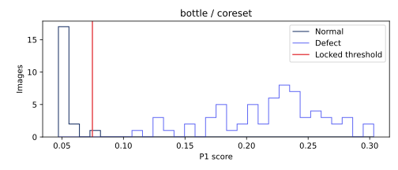

# bottle · coreset 비전 진단

이미지 83개. TP 63, FN 0, FP 1, TN 19. 고정 임계값 0.07478612754493952.

## 점수 분포


정상/불량 점수 범위의 교집합(경계 포함): {'definition': 'intersection of empirical normal/defect score ranges (inclusive)', 'range': None, 'normal_count': 0, 'defect_count': 0}. 확률적 중첩률이나 원인 판정이 아니다.

## 결함 유형별 성능
|유형|이미지|NG|탐지율(정상은 오탐률)|평균 점수|
|---|---:|---:|---:|---:|
|broken_large|20|20|1.000000|0.234083077|
|broken_small|22|22|1.000000|0.222954127|
|contamination|21|21|1.000000|0.199736297|
|good|20|1|0.050000|0.050769988|

## 배경 반응과 한계
오탐의 최대 raw 패치 반응이 배경 proxy에 있었던 비율: 0/1. 분모 0은 해당 없음.
정상 fit 이미지의 테두리 RGB 중앙값과의 색 거리 히스토그램에 Otsu를 적용한 고정 임계값이다. 테스트 이미지/GT로 튜닝하지 않았다. 이는 물체 GT가 아닌 색 기반 proxy다. 물체와 배경의 색이 비슷하거나 질감이 화면을 채우는 carpet에서는 특히 신뢰할 수 없다. 배경 간섭의 인과관계를 단정하지 않는다.

## 공정 영향
[600,3600] 본 라인 출구 전체(보류 포함)를 분모로 기존 reconstruct_b 결과를 인용한다. 사람 1명·30초·민감도/특이도 1 assumed. 파일럿 조건이 서로 달라 모델 효과의 직접 비교가 아니다.
```json
[
  {
    "run_id": "c90178b077fef27e",
    "cell": "robot",
    "speed": 0.5,
    "seed": 0,
    "latency_mode": "profile",
    "source_complete_sha256": "66e1e8db5e60a2b16af9ce7cdf3ef66a4dbdd9c3c6fe0d050eff440b1012f489",
    "parts_denominator": 400,
    "reinspection_per_1000": 95.0,
    "false_positives_per_1000": 52.5,
    "escaped_defects": 0,
    "escaped_defects_per_1000": 0.0
  },
  {
    "run_id": "e764bdbe5364d847",
    "cell": "inline",
    "speed": 0.75,
    "seed": 0,
    "latency_mode": "constant",
    "source_complete_sha256": "53cd03a58c98962641e577432b97ebe514592eb0d592d1e950298c49bf43be4e",
    "parts_denominator": 21782,
    "reinspection_per_1000": 96.2721513176017,
    "false_positives_per_1000": 47.24084106142687,
    "escaped_defects": 0,
    "escaped_defects_per_1000": 0.0
  }
]
```

## 오탐·미탐 갤러리
오탐은 점수 상위 8개, 미탐은 전부. 원본 외 비교 이미지는 짧은 변 256 resize → 중앙 224 crop 좌표로 정렬했다. GT 마스크는 보고서 표시 전용이다. 히트맵은 기존 EvidenceStore의 이미지별 min/max 상대 표시다.

### FP · bottle/test/good/001.png
점수 0.07678711414337158 · 임계값 0.07478612754493952 · 판정 NG · 최대 패치 [19, 21]
[원본](outputs/factory-evidence/43ad5a98ad2ae9f10da23cf5769edbe9/source.png) ·    

## 모델 간 차이
클래스 상위 REPORT.md와 report.json의 disagreements에 세 모델의 점수·판정을 같은 이미지 ID로 대조했다.
