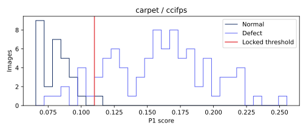

# carpet · ccifps 비전 진단

이미지 117개. TP 80, FN 9, FP 1, TN 27. 고정 임계값 0.10999169573187828.

## 점수 분포


정상/불량 점수 범위의 교집합(경계 포함): {'definition': 'intersection of empirical normal/defect score ranges (inclusive)', 'range': [0.0773535966873169, 0.11435413360595703], 'normal_count': 17, 'defect_count': 11}. 확률적 중첩률이나 원인 판정이 아니다.

## 결함 유형별 성능
|유형|이미지|NG|탐지율(정상은 오탐률)|평균 점수|
|---|---:|---:|---:|---:|
|color|19|18|0.947368|0.143916783|
|cut|17|17|1.000000|0.180486584|
|good|28|1|0.035714|0.081870317|
|hole|17|16|0.941176|0.171423551|
|metal_contamination|17|14|0.823529|0.139390714|
|thread|19|15|0.789474|0.161941550|

## 배경 반응과 한계
오탐의 최대 raw 패치 반응이 배경 proxy에 있었던 비율: 1/1. 분모 0은 해당 없음.
정상 fit 이미지의 테두리 RGB 중앙값과의 색 거리 히스토그램에 Otsu를 적용한 고정 임계값이다. 테스트 이미지/GT로 튜닝하지 않았다. 이는 물체 GT가 아닌 색 기반 proxy다. 물체와 배경의 색이 비슷하거나 질감이 화면을 채우는 carpet에서는 특히 신뢰할 수 없다. 배경 간섭의 인과관계를 단정하지 않는다.

## 공정 영향
[600,3600] 본 라인 출구 전체(보류 포함)를 분모로 기존 reconstruct_b 결과를 인용한다. 사람 1명·30초·민감도/특이도 1 assumed. 파일럿 조건이 서로 달라 모델 효과의 직접 비교가 아니다.
```json
[
  {
    "run_id": "64d67b7ebd198bd6",
    "cell": "inline",
    "speed": 0.5,
    "seed": 0,
    "latency_mode": "profile",
    "source_complete_sha256": "593207a60635e6164bc78c75eab6bc53ccf1903900b05e0443fd78dd513d2593",
    "parts_denominator": 14532,
    "reinspection_per_1000": 78.2411230388109,
    "false_positives_per_1000": 32.686484998623726,
    "escaped_defects": 63,
    "escaped_defects_per_1000": 4.335260115606936
  }
]
```

## 오탐·미탐 갤러리
오탐은 점수 상위 8개, 미탐은 전부. 원본 외 비교 이미지는 짧은 변 256 resize → 중앙 224 crop 좌표로 정렬했다. GT 마스크는 보고서 표시 전용이다. 히트맵은 기존 EvidenceStore의 이미지별 min/max 상대 표시다.

### FP · carpet/test/good/009.png
점수 0.11435413360595703 · 임계값 0.10999169573187828 · 판정 NG · 최대 패치 [14, 0]
[원본](outputs/factory-evidence/387b83a4163cad68dc6a9c0ff9b0f54b/source.png) ·    

### FN · carpet/test/color/002.png
점수 0.10400509834289551 · 임계값 0.10999169573187828 · 판정 OK · 최대 패치 [7, 7]
[원본](outputs/factory-evidence/1a057bf2998612b201f1f4439d64c8f3/source.png) ·    

### FN · carpet/test/hole/001.png
점수 0.09087347984313965 · 임계값 0.10999169573187828 · 판정 OK · 최대 패치 [5, 18]
[원본](outputs/factory-evidence/a3399a88caf6eff8fc502d66f33c5781/source.png) ·    

### FN · carpet/test/metal_contamination/000.png
점수 0.08403027057647705 · 임계값 0.10999169573187828 · 판정 OK · 최대 패치 [0, 27]
[원본](outputs/factory-evidence/f9c2753374284a8d96fc301f4c23e757/source.png) ·    

### FN · carpet/test/metal_contamination/001.png
점수 0.10019314289093018 · 임계값 0.10999169573187828 · 판정 OK · 최대 패치 [5, 17]
[원본](outputs/factory-evidence/ed3951251093bcdcccb21b73d62573a1/source.png) ·    

### FN · carpet/test/metal_contamination/014.png
점수 0.0989234447479248 · 임계값 0.10999169573187828 · 판정 OK · 최대 패치 [17, 22]
[원본](outputs/factory-evidence/533a49bc3abb32fd3aa29d72d37d92f5/source.png) ·    

### FN · carpet/test/thread/001.png
점수 0.09787392616271973 · 임계값 0.10999169573187828 · 판정 OK · 최대 패치 [16, 10]
[원본](outputs/factory-evidence/ab47bd5cea6df72add450ab00f7b01e8/source.png) ·    

### FN · carpet/test/thread/009.png
점수 0.09794008731842041 · 임계값 0.10999169573187828 · 판정 OK · 최대 패치 [12, 0]
[원본](outputs/factory-evidence/dcd9b5352a1531adad065b22428ac3e0/source.png) ·    

### FN · carpet/test/thread/015.png
점수 0.0879163146018982 · 임계값 0.10999169573187828 · 판정 OK · 최대 패치 [6, 0]
[원본](outputs/factory-evidence/1a3fc087d851536c2282508170074e5f/source.png) ·    

### FN · carpet/test/thread/018.png
점수 0.0773535966873169 · 임계값 0.10999169573187828 · 판정 OK · 최대 패치 [27, 27]
[원본](outputs/factory-evidence/d5b31e666c7bc1e8aee5d443433c1840/source.png) ·    

## 모델 간 차이
클래스 상위 REPORT.md와 report.json의 disagreements에 세 모델의 점수·판정을 같은 이미지 ID로 대조했다.
