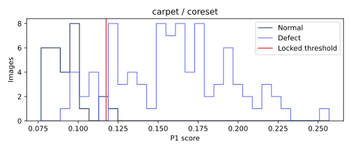

# carpet · coreset 비전 진단

이미지 117개. TP 78, FN 11, FP 1, TN 27. 고정 임계값 0.11749348416924477.

## 점수 분포


정상/불량 점수 범위의 교집합(경계 포함): {'definition': 'intersection of empirical normal/defect score ranges (inclusive)', 'range': [0.09207099676132202, 0.12214356660842896], 'normal_count': 13, 'defect_count': 14}. 확률적 중첩률이나 원인 판정이 아니다.

## 결함 유형별 성능
|유형|이미지|NG|탐지율(정상은 오탐률)|평균 점수|
|---|---:|---:|---:|---:|
|color|19|16|0.842105|0.143220007|
|cut|17|17|1.000000|0.181576410|
|good|28|1|0.035714|0.092712285|
|hole|17|16|0.941176|0.170970706|
|metal_contamination|17|14|0.823529|0.139942075|
|thread|19|15|0.789474|0.162786013|

## 배경 반응과 한계
오탐의 최대 raw 패치 반응이 배경 proxy에 있었던 비율: 1/1. 분모 0은 해당 없음.
정상 fit 이미지의 테두리 RGB 중앙값과의 색 거리 히스토그램에 Otsu를 적용한 고정 임계값이다. 테스트 이미지/GT로 튜닝하지 않았다. 이는 물체 GT가 아닌 색 기반 proxy다. 물체와 배경의 색이 비슷하거나 질감이 화면을 채우는 carpet에서는 특히 신뢰할 수 없다. 배경 간섭의 인과관계를 단정하지 않는다.

## 공정 영향
[600,3600] 본 라인 출구 전체(보류 포함)를 분모로 기존 reconstruct_b 결과를 인용한다. 사람 1명·30초·민감도/특이도 1 assumed. 파일럿 조건이 서로 달라 모델 효과의 직접 비교가 아니다.
```json
[
  {
    "run_id": "8ced11f8476a3116",
    "cell": "inline",
    "speed": 1.0,
    "seed": 0,
    "latency_mode": "profile",
    "source_complete_sha256": "2419b7eaf5fa834f768c405680a403fc7583e43e366191262d278c63370545ce",
    "parts_denominator": 29031,
    "reinspection_per_1000": 76.57331817712101,
    "false_positives_per_1000": 32.5169646240226,
    "escaped_defects": 170,
    "escaped_defects_per_1000": 5.855809307292205
  },
  {
    "run_id": "ad03087cef4fc2a1",
    "cell": "inline",
    "speed": 0.25,
    "seed": 0,
    "latency_mode": "constant",
    "source_complete_sha256": "bef7b500124cf7af3aca04f85c8f27e1fae1aef37dd0cb3616593479e9f5a863",
    "parts_denominator": 7283,
    "reinspection_per_1000": 75.79294246876287,
    "false_positives_per_1000": 35.01304407524372,
    "escaped_defects": 43,
    "escaped_defects_per_1000": 5.90416037347247
  }
]
```

## 오탐·미탐 갤러리
오탐은 점수 상위 8개, 미탐은 전부. 원본 외 비교 이미지는 짧은 변 256 resize → 중앙 224 crop 좌표로 정렬했다. GT 마스크는 보고서 표시 전용이다. 히트맵은 기존 EvidenceStore의 이미지별 min/max 상대 표시다.

### FP · carpet/test/good/009.png
점수 0.12214356660842896 · 임계값 0.11749348416924477 · 판정 NG · 최대 패치 [14, 0]
[원본](outputs/factory-evidence/db3ef9fd5b8b3ed88c1082842830376d/source.png) ·    

### FN · carpet/test/color/002.png
점수 0.11224192380905151 · 임계값 0.11749348416924477 · 판정 OK · 최대 패치 [7, 7]
[원본](outputs/factory-evidence/0660fa9bfbf9b7638ce2af96f73d2629/source.png) ·    

### FN · carpet/test/color/005.png
점수 0.11254876852035522 · 임계값 0.11749348416924477 · 판정 OK · 최대 패치 [5, 8]
[원본](outputs/factory-evidence/175c720d505337a501348715220f2144/source.png) ·    

### FN · carpet/test/color/014.png
점수 0.10710763931274414 · 임계값 0.11749348416924477 · 판정 OK · 최대 패치 [17, 15]
[원본](outputs/factory-evidence/c989f6edb6fe80702c806a6a40589bf4/source.png) ·    

### FN · carpet/test/hole/001.png
점수 0.09847003221511841 · 임계값 0.11749348416924477 · 판정 OK · 최대 패치 [5, 18]
[원본](outputs/factory-evidence/c870f1016e0495155455b3179a6f2b2c/source.png) ·    

### FN · carpet/test/metal_contamination/000.png
점수 0.09807491302490234 · 임계값 0.11749348416924477 · 판정 OK · 최대 패치 [0, 27]
[원본](outputs/factory-evidence/315f886d04a3cabd1c555535195adbbb/source.png) ·    

### FN · carpet/test/metal_contamination/001.png
점수 0.09531283378601074 · 임계값 0.11749348416924477 · 판정 OK · 최대 패치 [6, 17]
[원본](outputs/factory-evidence/fa89589b739782ebbed614f57c14f284/source.png) ·    

### FN · carpet/test/metal_contamination/014.png
점수 0.10095357894897461 · 임계값 0.11749348416924477 · 판정 OK · 최대 패치 [17, 22]
[원본](outputs/factory-evidence/fc3d7342985eafc52c8830ac4d1467d7/source.png) ·    

### FN · carpet/test/thread/001.png
점수 0.10147112607955933 · 임계값 0.11749348416924477 · 판정 OK · 최대 패치 [16, 10]
[원본](outputs/factory-evidence/b77d3a5fdc55048bd4521828766f7fae/source.png) ·    

### FN · carpet/test/thread/009.png
점수 0.10035210847854614 · 임계값 0.11749348416924477 · 판정 OK · 최대 패치 [12, 0]
[원본](outputs/factory-evidence/b8d245fbe39279f1510f346c0605dce2/source.png) ·    

### FN · carpet/test/thread/015.png
점수 0.09207099676132202 · 임계값 0.11749348416924477 · 판정 OK · 최대 패치 [6, 0]
[원본](outputs/factory-evidence/207eaf53eb0a459cbbcd1de103a41107/source.png) ·    

### FN · carpet/test/thread/018.png
점수 0.11093461513519287 · 임계값 0.11749348416924477 · 판정 OK · 최대 패치 [27, 27]
[원본](outputs/factory-evidence/aa56bbe559f83222fed12b30e76885f4/source.png) ·    

## 모델 간 차이
클래스 상위 REPORT.md와 report.json의 disagreements에 세 모델의 점수·판정을 같은 이미지 ID로 대조했다.
