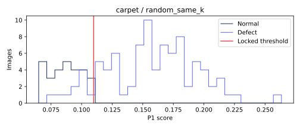

# carpet · random_same_k 비전 진단

이미지 117개. TP 80, FN 9, FP 1, TN 27. 고정 임계값 0.10986956674605608.

## 점수 분포


정상/불량 점수 범위의 교집합(경계 포함): {'definition': 'intersection of empirical normal/defect score ranges (inclusive)', 'range': [0.0773535966873169, 0.11041009426116943], 'normal_count': 20, 'defect_count': 9}. 확률적 중첩률이나 원인 판정이 아니다.

## 결함 유형별 성능
|유형|이미지|NG|탐지율(정상은 오탐률)|평균 점수|
|---|---:|---:|---:|---:|
|color|19|19|1.000000|0.145185775|
|cut|17|17|1.000000|0.176918889|
|good|28|1|0.035714|0.087378161|
|hole|17|16|0.941176|0.167112056|
|metal_contamination|17|13|0.764706|0.136733942|
|thread|19|15|0.789474|0.160203727|

## 배경 반응과 한계
오탐의 최대 raw 패치 반응이 배경 proxy에 있었던 비율: 0/1. 분모 0은 해당 없음.
정상 fit 이미지의 테두리 RGB 중앙값과의 색 거리 히스토그램에 Otsu를 적용한 고정 임계값이다. 테스트 이미지/GT로 튜닝하지 않았다. 이는 물체 GT가 아닌 색 기반 proxy다. 물체와 배경의 색이 비슷하거나 질감이 화면을 채우는 carpet에서는 특히 신뢰할 수 없다. 배경 간섭의 인과관계를 단정하지 않는다.

## 공정 영향
[600,3600] 본 라인 출구 전체(보류 포함)를 분모로 기존 reconstruct_b 결과를 인용한다. 사람 1명·30초·민감도/특이도 1 assumed. 파일럿 조건이 서로 달라 모델 효과의 직접 비교가 아니다.
```json
[
  {
    "run_id": "888ddf2b7943f09e",
    "cell": "robot",
    "speed": 0.5,
    "seed": 0,
    "latency_mode": "profile",
    "source_complete_sha256": "9593342ffced7a113892554f967989b778462c3044909bb0ce11a5abd1a941a5",
    "parts_denominator": 399,
    "reinspection_per_1000": 100.25062656641603,
    "false_positives_per_1000": 60.150375939849624,
    "escaped_defects": 1,
    "escaped_defects_per_1000": 2.506265664160401
  },
  {
    "run_id": "ccd5e5b8884b6816",
    "cell": "inline",
    "speed": 0.75,
    "seed": 0,
    "latency_mode": "constant",
    "source_complete_sha256": "2be1a4c0dc9d73e8b59e1002002e93ed5e0f2396417b75692a79b58b1c37359a",
    "parts_denominator": 21781,
    "reinspection_per_1000": 81.12575180202928,
    "false_positives_per_1000": 36.40787842615123,
    "escaped_defects": 94,
    "escaped_defects_per_1000": 4.315687984941003
  }
]
```

## 오탐·미탐 갤러리
오탐은 점수 상위 8개, 미탐은 전부. 원본 외 비교 이미지는 짧은 변 256 resize → 중앙 224 crop 좌표로 정렬했다. GT 마스크는 보고서 표시 전용이다. 히트맵은 기존 EvidenceStore의 이미지별 min/max 상대 표시다.

### FP · carpet/test/good/019.png
점수 0.11041009426116943 · 임계값 0.10986956674605608 · 판정 NG · 최대 패치 [27, 0]
[원본](outputs/factory-evidence/e3cb5c17eb00c8b72f01294084793425/source.png) ·    

### FN · carpet/test/hole/001.png
점수 0.09524500370025635 · 임계값 0.10986956674605608 · 판정 OK · 최대 패치 [5, 18]
[원본](outputs/factory-evidence/2a47d7870d40fb48021428df9eac08e7/source.png) ·    

### FN · carpet/test/metal_contamination/000.png
점수 0.08435463905334473 · 임계값 0.10986956674605608 · 판정 OK · 최대 패치 [0, 0]
[원본](outputs/factory-evidence/0a341fa556c66e1c5fad97cd25d5a7d8/source.png) ·    

### FN · carpet/test/metal_contamination/001.png
점수 0.10025477409362793 · 임계값 0.10986956674605608 · 판정 OK · 최대 패치 [5, 17]
[원본](outputs/factory-evidence/68e087e757cf923edd6391433d399b80/source.png) ·    

### FN · carpet/test/metal_contamination/011.png
점수 0.10407507419586182 · 임계값 0.10986956674605608 · 판정 OK · 최대 패치 [20, 21]
[원본](outputs/factory-evidence/65184d5147b363540764a05671f514c4/source.png) ·    

### FN · carpet/test/metal_contamination/014.png
점수 0.09149086475372314 · 임계값 0.10986956674605608 · 판정 OK · 최대 패치 [17, 21]
[원본](outputs/factory-evidence/965495f6bf5bdea673f81b70b8abc623/source.png) ·    

### FN · carpet/test/thread/001.png
점수 0.09800130128860474 · 임계값 0.10986956674605608 · 판정 OK · 최대 패치 [16, 10]
[원본](outputs/factory-evidence/84f80dc16e8bfb87536437715c0294c7/source.png) ·    

### FN · carpet/test/thread/009.png
점수 0.09967732429504395 · 임계값 0.10986956674605608 · 판정 OK · 최대 패치 [12, 0]
[원본](outputs/factory-evidence/7b57e5493bcc6d6884d0c3bf2514ad59/source.png) ·    

### FN · carpet/test/thread/015.png
점수 0.08640933036804199 · 임계값 0.10986956674605608 · 판정 OK · 최대 패치 [5, 0]
[원본](outputs/factory-evidence/b2291aac93962ce4fcc701a6e38f62a4/source.png) ·    

### FN · carpet/test/thread/018.png
점수 0.0773535966873169 · 임계값 0.10986956674605608 · 판정 OK · 최대 패치 [27, 27]
[원본](outputs/factory-evidence/c21713b7c459f1d9ad0baf2168edb0d6/source.png) ·    

## 모델 간 차이
클래스 상위 REPORT.md와 report.json의 disagreements에 세 모델의 점수·판정을 같은 이미지 ID로 대조했다.
