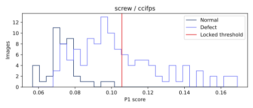

# screw · ccifps 비전 진단

이미지 160개. TP 44, FN 75, FP 0, TN 41. 고정 임계값 0.10567171033471823.

## 점수 분포


정상/불량 점수 범위의 교집합(경계 포함): {'definition': 'intersection of empirical normal/defect score ranges (inclusive)', 'range': [0.068264901638031, 0.10117840766906738], 'normal_count': 34, 'defect_count': 65}. 확률적 중첩률이나 원인 판정이 아니다.

## 결함 유형별 성능
|유형|이미지|NG|탐지율(정상은 오탐률)|평균 점수|
|---|---:|---:|---:|---:|
|good|41|0|0.000000|0.073501857|
|manipulated_front|24|12|0.500000|0.103952833|
|scratch_head|24|6|0.250000|0.098431796|
|scratch_neck|25|19|0.760000|0.130496790|
|thread_side|23|1|0.043478|0.085755830|
|thread_top|23|6|0.260870|0.099944628|

## 배경 반응과 한계
오탐의 최대 raw 패치 반응이 배경 proxy에 있었던 비율: 0/0. 분모 0은 해당 없음.
정상 fit 이미지의 테두리 RGB 중앙값과의 색 거리 히스토그램에 Otsu를 적용한 고정 임계값이다. 테스트 이미지/GT로 튜닝하지 않았다. 이는 물체 GT가 아닌 색 기반 proxy다. 물체와 배경의 색이 비슷하거나 질감이 화면을 채우는 carpet에서는 특히 신뢰할 수 없다. 배경 간섭의 인과관계를 단정하지 않는다.

## 공정 영향
[600,3600] 본 라인 출구 전체(보류 포함)를 분모로 기존 reconstruct_b 결과를 인용한다. 사람 1명·30초·민감도/특이도 1 assumed. 파일럿 조건이 서로 달라 모델 효과의 직접 비교가 아니다.
```json
[
  {
    "run_id": "6e17ce8447426140",
    "cell": "robot",
    "speed": 0.5,
    "seed": 0,
    "latency_mode": "profile",
    "source_complete_sha256": "9e13bf7f1e7270de02f16c9bf3f87e0c9be89632e3801c7adf3a8eb9b1de5359",
    "parts_denominator": 401,
    "reinspection_per_1000": 14.962593516209475,
    "false_positives_per_1000": 0.0,
    "escaped_defects": 11,
    "escaped_defects_per_1000": 27.43142144638404
  },
  {
    "run_id": "7a6b1db34515ade7",
    "cell": "inline",
    "speed": 0.75,
    "seed": 0,
    "latency_mode": "constant",
    "source_complete_sha256": "b2d457c9391027cc94f4f667921baddeb73179fe17296c0189ed2770ebf9a4b3",
    "parts_denominator": 21782,
    "reinspection_per_1000": 17.95060141401157,
    "false_positives_per_1000": 0.0,
    "escaped_defects": 677,
    "escaped_defects_per_1000": 31.080708842163254
  }
]
```

## 오탐·미탐 갤러리
오탐은 점수 상위 8개, 미탐은 전부. 원본 외 비교 이미지는 짧은 변 256 resize → 중앙 224 crop 좌표로 정렬했다. GT 마스크는 보고서 표시 전용이다. 히트맵은 기존 EvidenceStore의 이미지별 min/max 상대 표시다.

### FN · screw/test/manipulated_front/000.png
점수 0.10039699077606201 · 임계값 0.10567171033471823 · 판정 OK · 최대 패치 [27, 11]
[원본](outputs/factory-evidence/5c07fb31c441447f3dee3790b5e8dbe9/source.png) ·    

### FN · screw/test/manipulated_front/001.png
점수 0.10375070571899414 · 임계값 0.10567171033471823 · 판정 OK · 최대 패치 [23, 25]
[원본](outputs/factory-evidence/8d4ac9e2b88f4ff4dabc35e991e003b2/source.png) ·    

### FN · screw/test/manipulated_front/003.png
점수 0.10231077671051025 · 임계값 0.10567171033471823 · 판정 OK · 최대 패치 [0, 8]
[원본](outputs/factory-evidence/595bd04108ef27a4642fc38129eb1608/source.png) ·    

### FN · screw/test/manipulated_front/006.png
점수 0.09173697233200073 · 임계값 0.10567171033471823 · 판정 OK · 최대 패치 [3, 24]
[원본](outputs/factory-evidence/9c193c9ddfe507e7ca0cadd9ca0e1815/source.png) ·    

### FN · screw/test/manipulated_front/007.png
점수 0.10039019584655762 · 임계값 0.10567171033471823 · 판정 OK · 최대 패치 [0, 21]
[원본](outputs/factory-evidence/96ab737d5390d8a7f188dd2536ae3cb7/source.png) ·    

### FN · screw/test/manipulated_front/009.png
점수 0.08998000621795654 · 임계값 0.10567171033471823 · 판정 OK · 최대 패치 [3, 24]
[원본](outputs/factory-evidence/856ef3c672f425ee1637e028849a5902/source.png) ·    

### FN · screw/test/manipulated_front/013.png
점수 0.08793807029724121 · 임계값 0.10567171033471823 · 판정 OK · 최대 패치 [7, 24]
[원본](outputs/factory-evidence/5d8fbb7073571d2a917c1bf1dbe89b7c/source.png) ·    

### FN · screw/test/manipulated_front/014.png
점수 0.09501206874847412 · 임계값 0.10567171033471823 · 판정 OK · 최대 패치 [5, 2]
[원본](outputs/factory-evidence/9c1fba1aaf7401cdca5dc9c985148620/source.png) ·    

### FN · screw/test/manipulated_front/017.png
점수 0.07942312955856323 · 임계값 0.10567171033471823 · 판정 OK · 최대 패치 [26, 6]
[원본](outputs/factory-evidence/008fbe1d5d28a9480371fd064af53cdd/source.png) ·    

### FN · screw/test/manipulated_front/018.png
점수 0.1002892255783081 · 임계값 0.10567171033471823 · 판정 OK · 최대 패치 [0, 15]
[원본](outputs/factory-evidence/e264090b7798975c28e1103a6121f459/source.png) ·    

### FN · screw/test/manipulated_front/020.png
점수 0.07166463136672974 · 임계값 0.10567171033471823 · 판정 OK · 최대 패치 [4, 25]
[원본](outputs/factory-evidence/3dbbc81e589df7730aa0cfbd43e2965b/source.png) ·    

### FN · screw/test/manipulated_front/021.png
점수 0.07373011112213135 · 임계값 0.10567171033471823 · 판정 OK · 최대 패치 [26, 4]
[원본](outputs/factory-evidence/dafe071fc97ba5d07db243b8ee41f080/source.png) ·    

### FN · screw/test/scratch_head/000.png
점수 0.10044270753860474 · 임계값 0.10567171033471823 · 판정 OK · 최대 패치 [8, 5]
[원본](outputs/factory-evidence/abe80eef9ccdec0eb03a3e6d40579e07/source.png) ·    

### FN · screw/test/scratch_head/002.png
점수 0.0978659987449646 · 임계값 0.10567171033471823 · 판정 OK · 최대 패치 [7, 6]
[원본](outputs/factory-evidence/56b587ec5dc27adfdf8d4e20c5dbaf06/source.png) ·    

### FN · screw/test/scratch_head/003.png
점수 0.07992303371429443 · 임계값 0.10567171033471823 · 판정 OK · 최대 패치 [14, 1]
[원본](outputs/factory-evidence/f6cd19e52770e64599f855c58e2f6a1f/source.png) ·    

### FN · screw/test/scratch_head/004.png
점수 0.08072316646575928 · 임계값 0.10567171033471823 · 판정 OK · 최대 패치 [20, 5]
[원본](outputs/factory-evidence/eb43f2cf0f9fd297f074e2b792927a6e/source.png) ·    

### FN · screw/test/scratch_head/005.png
점수 0.09861284494400024 · 임계값 0.10567171033471823 · 판정 OK · 최대 패치 [25, 15]
[원본](outputs/factory-evidence/f5f637a05b23e077ac4233dd8c5a949b/source.png) ·    

### FN · screw/test/scratch_head/006.png
점수 0.08025926351547241 · 임계값 0.10567171033471823 · 판정 OK · 최대 패치 [9, 24]
[원본](outputs/factory-evidence/9b1ceedfd29566b89e43bfa5ed34e851/source.png) ·    

### FN · screw/test/scratch_head/008.png
점수 0.07840520143508911 · 임계값 0.10567171033471823 · 판정 OK · 최대 패치 [5, 7]
[원본](outputs/factory-evidence/4512c60ea4fcf7d6d9a0f6166b64be11/source.png) ·    

### FN · screw/test/scratch_head/009.png
점수 0.08972823619842529 · 임계값 0.10567171033471823 · 판정 OK · 최대 패치 [13, 0]
[원본](outputs/factory-evidence/017c3c277a23cd56ac06655bf3d5a5ce/source.png) ·    

### FN · screw/test/scratch_head/010.png
점수 0.1037788987159729 · 임계값 0.10567171033471823 · 판정 OK · 최대 패치 [24, 8]
[원본](outputs/factory-evidence/f996077f7725eaf4460d9013833fc178/source.png) ·    

### FN · screw/test/scratch_head/012.png
점수 0.09591269493103027 · 임계값 0.10567171033471823 · 판정 OK · 최대 패치 [7, 5]
[원본](outputs/factory-evidence/e403b343c848c5d0ddb618403bccba8a/source.png) ·    

### FN · screw/test/scratch_head/013.png
점수 0.09165418148040771 · 임계값 0.10567171033471823 · 판정 OK · 최대 패치 [9, 25]
[원본](outputs/factory-evidence/e31c218dd36dbe2d007f9a207e5326d6/source.png) ·    

### FN · screw/test/scratch_head/014.png
점수 0.08867579698562622 · 임계값 0.10567171033471823 · 판정 OK · 최대 패치 [2, 10]
[원본](outputs/factory-evidence/77639d3c0704708bc7d49a3cc8acdaae/source.png) ·    

### FN · screw/test/scratch_head/016.png
점수 0.0978803038597107 · 임계값 0.10567171033471823 · 판정 OK · 최대 패치 [25, 16]
[원본](outputs/factory-evidence/3d88b5babd095d0a3953e22b22f4934e/source.png) ·    

### FN · screw/test/scratch_head/019.png
점수 0.10413730144500732 · 임계값 0.10567171033471823 · 판정 OK · 최대 패치 [9, 19]
[원본](outputs/factory-evidence/ba1ddc8836c583de8c1c298624d6206e/source.png) ·    

### FN · screw/test/scratch_head/020.png
점수 0.08944261074066162 · 임계값 0.10567171033471823 · 판정 OK · 최대 패치 [2, 12]
[원본](outputs/factory-evidence/35ad1bb0c1f122519c7d3cc60facaf33/source.png) ·    

### FN · screw/test/scratch_head/021.png
점수 0.09160768985748291 · 임계값 0.10567171033471823 · 판정 OK · 최대 패치 [23, 2]
[원본](outputs/factory-evidence/28108dcce6fddd8d7d37ae962644d2f3/source.png) ·    

### FN · screw/test/scratch_head/022.png
점수 0.09861654043197632 · 임계값 0.10567171033471823 · 판정 OK · 최대 패치 [0, 11]
[원본](outputs/factory-evidence/fec65afbc704d549b631d0f075fe6254/source.png) ·    

### FN · screw/test/scratch_head/023.png
점수 0.08693534135818481 · 임계값 0.10567171033471823 · 판정 OK · 최대 패치 [9, 24]
[원본](outputs/factory-evidence/63846e1b6d36b0596eaadb3b84161e4d/source.png) ·    

### FN · screw/test/scratch_neck/000.png
점수 0.08314311504364014 · 임계값 0.10567171033471823 · 판정 OK · 최대 패치 [7, 11]
[원본](outputs/factory-evidence/5468452654c025653712338dd90590dc/source.png) ·    

### FN · screw/test/scratch_neck/002.png
점수 0.10120397806167603 · 임계값 0.10567171033471823 · 판정 OK · 최대 패치 [11, 13]
[원본](outputs/factory-evidence/d404ad8953384231f34d9bf31fe20de0/source.png) ·    

### FN · screw/test/scratch_neck/005.png
점수 0.07495290040969849 · 임계값 0.10567171033471823 · 판정 OK · 최대 패치 [25, 2]
[원본](outputs/factory-evidence/1c6be4ccdfcb8d33bb38b50bc91eb63e/source.png) ·    

### FN · screw/test/scratch_neck/011.png
점수 0.09089618921279907 · 임계값 0.10567171033471823 · 판정 OK · 최대 패치 [14, 11]
[원본](outputs/factory-evidence/1ea3902f1b6a8c2aa85fd62fef87efb1/source.png) ·    

### FN · screw/test/scratch_neck/021.png
점수 0.09627020359039307 · 임계값 0.10567171033471823 · 판정 OK · 최대 패치 [15, 15]
[원본](outputs/factory-evidence/b5a734a4f2d410cdb04c2ac02a665803/source.png) ·    

### FN · screw/test/scratch_neck/023.png
점수 0.10238152742385864 · 임계값 0.10567171033471823 · 판정 OK · 최대 패치 [10, 10]
[원본](outputs/factory-evidence/3c046b65d436d7c39d4eb54970e3ab5b/source.png) ·    

### FN · screw/test/thread_side/000.png
점수 0.09359174966812134 · 임계값 0.10567171033471823 · 판정 OK · 최대 패치 [0, 27]
[원본](outputs/factory-evidence/505ead43453bd92a687c95ad108ee27c/source.png) ·    

### FN · screw/test/thread_side/001.png
점수 0.07362359762191772 · 임계값 0.10567171033471823 · 판정 OK · 최대 패치 [0, 15]
[원본](outputs/factory-evidence/5d4897d15db82190ab98b4e1cfcecba6/source.png) ·    

### FN · screw/test/thread_side/002.png
점수 0.09620773792266846 · 임계값 0.10567171033471823 · 판정 OK · 최대 패치 [13, 0]
[원본](outputs/factory-evidence/0c35138eb2d4c12c25fde0b6ef53fbc5/source.png) ·    

### FN · screw/test/thread_side/003.png
점수 0.08959710597991943 · 임계값 0.10567171033471823 · 판정 OK · 최대 패치 [19, 15]
[원본](outputs/factory-evidence/a8b7fabc11e240b04d09fc62cba5064a/source.png) ·    

### FN · screw/test/thread_side/004.png
점수 0.0709298849105835 · 임계값 0.10567171033471823 · 판정 OK · 최대 패치 [14, 14]
[원본](outputs/factory-evidence/520bee5cf856a86609fa5c640b81caf5/source.png) ·    

### FN · screw/test/thread_side/005.png
점수 0.08996981382369995 · 임계값 0.10567171033471823 · 판정 OK · 최대 패치 [10, 11]
[원본](outputs/factory-evidence/d6086f4351ca30b924db9351529cd2f1/source.png) ·    

### FN · screw/test/thread_side/006.png
점수 0.07991522550582886 · 임계값 0.10567171033471823 · 판정 OK · 최대 패치 [10, 10]
[원본](outputs/factory-evidence/d667279fc70de91c99ff33f340a2bc14/source.png) ·    

### FN · screw/test/thread_side/007.png
점수 0.09764468669891357 · 임계값 0.10567171033471823 · 판정 OK · 최대 패치 [16, 15]
[원본](outputs/factory-evidence/b8d313b6c9ac7a86e6685869e722ec18/source.png) ·    

### FN · screw/test/thread_side/008.png
점수 0.07898390293121338 · 임계값 0.10567171033471823 · 판정 OK · 최대 패치 [20, 9]
[원본](outputs/factory-evidence/f810798a5151fb640d8b56f24590f7b5/source.png) ·    

### FN · screw/test/thread_side/009.png
점수 0.08557933568954468 · 임계값 0.10567171033471823 · 판정 OK · 최대 패치 [2, 16]
[원본](outputs/factory-evidence/2b60534e5ed1014ed7b3932c568d0de7/source.png) ·    

### FN · screw/test/thread_side/010.png
점수 0.07251369953155518 · 임계값 0.10567171033471823 · 판정 OK · 최대 패치 [9, 14]
[원본](outputs/factory-evidence/273e11443c4f0399161527129a995d42/source.png) ·    

### FN · screw/test/thread_side/011.png
점수 0.09615552425384521 · 임계값 0.10567171033471823 · 판정 OK · 최대 패치 [27, 10]
[원본](outputs/factory-evidence/5ddc6785ee877cf4d820f67b412ee69d/source.png) ·    

### FN · screw/test/thread_side/012.png
점수 0.07395744323730469 · 임계값 0.10567171033471823 · 판정 OK · 최대 패치 [27, 2]
[원본](outputs/factory-evidence/11ed5a55928b043ed368a87879bfb8f3/source.png) ·    

### FN · screw/test/thread_side/013.png
점수 0.07523709535598755 · 임계값 0.10567171033471823 · 판정 OK · 최대 패치 [14, 12]
[원본](outputs/factory-evidence/f9def9a21c1b0a373647df734395784f/source.png) ·    

### FN · screw/test/thread_side/014.png
점수 0.08926314115524292 · 임계값 0.10567171033471823 · 판정 OK · 최대 패치 [12, 7]
[원본](outputs/factory-evidence/b38226835d83cda84e0dc7dc0a890346/source.png) ·    

### FN · screw/test/thread_side/015.png
점수 0.07621580362319946 · 임계값 0.10567171033471823 · 판정 OK · 최대 패치 [27, 15]
[원본](outputs/factory-evidence/fef1f6493dd86ea46e1e35bf86dddc92/source.png) ·    

### FN · screw/test/thread_side/016.png
점수 0.08263230323791504 · 임계값 0.10567171033471823 · 판정 OK · 최대 패치 [27, 27]
[원본](outputs/factory-evidence/be8d2a433ead2e93e0f4e481e6536fd2/source.png) ·    

### FN · screw/test/thread_side/017.png
점수 0.10557341575622559 · 임계값 0.10567171033471823 · 판정 OK · 최대 패치 [16, 6]
[원본](outputs/factory-evidence/3abbeb0194ed9f1cb2212d95fc666a8d/source.png) ·    

### FN · screw/test/thread_side/019.png
점수 0.0909203290939331 · 임계값 0.10567171033471823 · 판정 OK · 최대 패치 [3, 26]
[원본](outputs/factory-evidence/ca65548c02355f8012df525cbd66de04/source.png) ·    

### FN · screw/test/thread_side/020.png
점수 0.07279205322265625 · 임계값 0.10567171033471823 · 판정 OK · 최대 패치 [21, 9]
[원본](outputs/factory-evidence/24439ea831d1668d2f1121fb4a8eb029/source.png) ·    

### FN · screw/test/thread_side/021.png
점수 0.068264901638031 · 임계값 0.10567171033471823 · 판정 OK · 최대 패치 [21, 18]
[원본](outputs/factory-evidence/99e3446b5ab3828cddabbb99060fe6a4/source.png) ·    

### FN · screw/test/thread_side/022.png
점수 0.1004137396812439 · 임계값 0.10567171033471823 · 판정 OK · 최대 패치 [26, 0]
[원본](outputs/factory-evidence/7cc7d8b213f8ea5157ddc62e3ce065d3/source.png) ·    

### FN · screw/test/thread_top/000.png
점수 0.09188860654830933 · 임계값 0.10567171033471823 · 판정 OK · 최대 패치 [7, 8]
[원본](outputs/factory-evidence/742e4e8cbed7d963276eab6d83801864/source.png) ·    

### FN · screw/test/thread_top/002.png
점수 0.10195261240005493 · 임계값 0.10567171033471823 · 판정 OK · 최대 패치 [9, 18]
[원본](outputs/factory-evidence/40c72b49ead1795d26405d2baf1672a6/source.png) ·    

### FN · screw/test/thread_top/003.png
점수 0.07287275791168213 · 임계값 0.10567171033471823 · 판정 OK · 최대 패치 [7, 22]
[원본](outputs/factory-evidence/73442cfe353461bdc2a69a3c7417b708/source.png) ·    

### FN · screw/test/thread_top/004.png
점수 0.09671270847320557 · 임계값 0.10567171033471823 · 판정 OK · 최대 패치 [18, 16]
[원본](outputs/factory-evidence/71996468c23d6ab9218da650737ed2f8/source.png) ·    

### FN · screw/test/thread_top/006.png
점수 0.1051943302154541 · 임계값 0.10567171033471823 · 판정 OK · 최대 패치 [8, 19]
[원본](outputs/factory-evidence/2b36c4a3894d8179a0cbe0b2f739d376/source.png) ·    

### FN · screw/test/thread_top/008.png
점수 0.09392720460891724 · 임계값 0.10567171033471823 · 판정 OK · 최대 패치 [10, 0]
[원본](outputs/factory-evidence/476b91158c82b34829930a7eea77acfc/source.png) ·    

### FN · screw/test/thread_top/009.png
점수 0.08236455917358398 · 임계값 0.10567171033471823 · 판정 OK · 최대 패치 [0, 22]
[원본](outputs/factory-evidence/3788fd8dcbdfe5090ddbd29599cdc645/source.png) ·    

### FN · screw/test/thread_top/010.png
점수 0.07774066925048828 · 임계값 0.10567171033471823 · 판정 OK · 최대 패치 [9, 9]
[원본](outputs/factory-evidence/bae5b65a57aa0cc93bdf1e4abf8d7aae/source.png) ·    

### FN · screw/test/thread_top/011.png
점수 0.09509128332138062 · 임계값 0.10567171033471823 · 판정 OK · 최대 패치 [10, 16]
[원본](outputs/factory-evidence/ddf29257ac0c8bbe307d5959cdd4b0d7/source.png) ·    

### FN · screw/test/thread_top/012.png
점수 0.09450185298919678 · 임계값 0.10567171033471823 · 판정 OK · 최대 패치 [8, 23]
[원본](outputs/factory-evidence/34403b50d5a1f13202e382e5eb3b1e5b/source.png) ·    

### FN · screw/test/thread_top/014.png
점수 0.07909882068634033 · 임계값 0.10567171033471823 · 판정 OK · 최대 패치 [18, 17]
[원본](outputs/factory-evidence/f0c3d5f0abbc7fa9c2cdc4e312bc0dec/source.png) ·    

### FN · screw/test/thread_top/015.png
점수 0.09431678056716919 · 임계값 0.10567171033471823 · 판정 OK · 최대 패치 [21, 27]
[원본](outputs/factory-evidence/9ce909e5d12a9037c7592aa8a4112e9e/source.png) ·    

### FN · screw/test/thread_top/016.png
점수 0.10133278369903564 · 임계값 0.10567171033471823 · 판정 OK · 최대 패치 [17, 4]
[원본](outputs/factory-evidence/8a55b1274000775a06f137ef07883358/source.png) ·    

### FN · screw/test/thread_top/017.png
점수 0.08325022459030151 · 임계값 0.10567171033471823 · 판정 OK · 최대 패치 [23, 3]
[원본](outputs/factory-evidence/824582eb0b2d8a8e4bada95fc21b80d3/source.png) ·    

### FN · screw/test/thread_top/018.png
점수 0.09763705730438232 · 임계값 0.10567171033471823 · 판정 OK · 최대 패치 [16, 15]
[원본](outputs/factory-evidence/627bf77e4442be187a2c2f4b873810bf/source.png) ·    

### FN · screw/test/thread_top/021.png
점수 0.10049664974212646 · 임계값 0.10567171033471823 · 판정 OK · 최대 패치 [20, 19]
[원본](outputs/factory-evidence/21a61ad14aab29273f66e0fd055995a9/source.png) ·    

### FN · screw/test/thread_top/022.png
점수 0.08355414867401123 · 임계값 0.10567171033471823 · 판정 OK · 최대 패치 [4, 25]
[원본](outputs/factory-evidence/bcc9f76085f6ec30acec72ffdd6c5420/source.png) ·    

## 모델 간 차이
클래스 상위 REPORT.md와 report.json의 disagreements에 세 모델의 점수·판정을 같은 이미지 ID로 대조했다.
