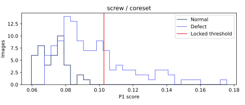

# screw · coreset 비전 진단

이미지 160개. TP 37, FN 82, FP 0, TN 41. 고정 임계값 0.10270808544009924.

## 점수 분포


정상/불량 점수 범위의 교집합(경계 포함): {'definition': 'intersection of empirical normal/defect score ranges (inclusive)', 'range': [0.06741929054260254, 0.09416460990905762], 'normal_count': 27, 'defect_count': 63}. 확률적 중첩률이나 원인 판정이 아니다.

## 결함 유형별 성능
|유형|이미지|NG|탐지율(정상은 오탐률)|평균 점수|
|---|---:|---:|---:|---:|
|good|41|0|0.000000|0.072893857|
|manipulated_front|24|7|0.291667|0.095014108|
|scratch_head|24|6|0.250000|0.090311845|
|scratch_neck|25|19|0.760000|0.122127137|
|thread_side|23|0|0.000000|0.081228624|
|thread_top|23|5|0.217391|0.094811149|

## 배경 반응과 한계
오탐의 최대 raw 패치 반응이 배경 proxy에 있었던 비율: 0/0. 분모 0은 해당 없음.
정상 fit 이미지의 테두리 RGB 중앙값과의 색 거리 히스토그램에 Otsu를 적용한 고정 임계값이다. 테스트 이미지/GT로 튜닝하지 않았다. 이는 물체 GT가 아닌 색 기반 proxy다. 물체와 배경의 색이 비슷하거나 질감이 화면을 채우는 carpet에서는 특히 신뢰할 수 없다. 배경 간섭의 인과관계를 단정하지 않는다.

## 공정 영향
[600,3600] 본 라인 출구 전체(보류 포함)를 분모로 기존 reconstruct_b 결과를 인용한다. 사람 1명·30초·민감도/특이도 1 assumed. 파일럿 조건이 서로 달라 모델 효과의 직접 비교가 아니다.
```json
[
  {
    "run_id": "8dd8e446a095de96",
    "cell": "inline",
    "speed": 0.5,
    "seed": 0,
    "latency_mode": "profile",
    "source_complete_sha256": "82e216265675a69dae54418501a0a019f28fad7774a8251210888efa08ba6ba7",
    "parts_denominator": 14532,
    "reinspection_per_1000": 15.483071841453343,
    "false_positives_per_1000": 0.0,
    "escaped_defects": 500,
    "escaped_defects_per_1000": 34.40682631434076
  }
]
```

## 오탐·미탐 갤러리
오탐은 점수 상위 8개, 미탐은 전부. 원본 외 비교 이미지는 짧은 변 256 resize → 중앙 224 crop 좌표로 정렬했다. GT 마스크는 보고서 표시 전용이다. 히트맵은 기존 EvidenceStore의 이미지별 min/max 상대 표시다.

### FN · screw/test/manipulated_front/000.png
점수 0.09646350145339966 · 임계값 0.10270808544009924 · 판정 OK · 최대 패치 [27, 11]
[원본](outputs/factory-evidence/f4102c7813f04584251ec93cfa6b6d4e/source.png) ·    

### FN · screw/test/manipulated_front/001.png
점수 0.09419858455657959 · 임계값 0.10270808544009924 · 판정 OK · 최대 패치 [24, 25]
[원본](outputs/factory-evidence/f5e2490f6535da41aa6134aa7b7fa31a/source.png) ·    

### FN · screw/test/manipulated_front/003.png
점수 0.08661746978759766 · 임계값 0.10270808544009924 · 판정 OK · 최대 패치 [2, 7]
[원본](outputs/factory-evidence/f0afdaf9f3fda452bf2b3106a5120585/source.png) ·    

### FN · screw/test/manipulated_front/004.png
점수 0.09417349100112915 · 임계값 0.10270808544009924 · 판정 OK · 최대 패치 [22, 2]
[원본](outputs/factory-evidence/fd7d96913eb73b1f93ab83bbc39c2868/source.png) ·    

### FN · screw/test/manipulated_front/006.png
점수 0.07625174522399902 · 임계값 0.10270808544009924 · 판정 OK · 최대 패치 [2, 24]
[원본](outputs/factory-evidence/3a5fab1ee5fd9a321555954a9317d0a7/source.png) ·    

### FN · screw/test/manipulated_front/007.png
점수 0.08632200956344604 · 임계값 0.10270808544009924 · 판정 OK · 최대 패치 [2, 21]
[원본](outputs/factory-evidence/f78653cab0b0dae4035b348c660d009c/source.png) ·    

### FN · screw/test/manipulated_front/009.png
점수 0.09018498659133911 · 임계값 0.10270808544009924 · 판정 OK · 최대 패치 [2, 24]
[원본](outputs/factory-evidence/75e84e519f15df0a3985ce4e7dcea012/source.png) ·    

### FN · screw/test/manipulated_front/011.png
점수 0.09827065467834473 · 임계값 0.10270808544009924 · 판정 OK · 최대 패치 [27, 6]
[원본](outputs/factory-evidence/86f0c319de42bd10f5d4a4f485e23750/source.png) ·    

### FN · screw/test/manipulated_front/012.png
점수 0.09876424074172974 · 임계값 0.10270808544009924 · 판정 OK · 최대 패치 [13, 0]
[원본](outputs/factory-evidence/ce1e13279de350a24661e363fb82aa84/source.png) ·    

### FN · screw/test/manipulated_front/013.png
점수 0.07159656286239624 · 임계값 0.10270808544009924 · 판정 OK · 최대 패치 [23, 25]
[원본](outputs/factory-evidence/ef7a5767e44e7656e8a50fb2c0686cda/source.png) ·    

### FN · screw/test/manipulated_front/014.png
점수 0.08465743064880371 · 임계값 0.10270808544009924 · 판정 OK · 최대 패치 [5, 2]
[원본](outputs/factory-evidence/ba6865b622b393a89fb53a4dc90219de/source.png) ·    

### FN · screw/test/manipulated_front/016.png
점수 0.09432655572891235 · 임계값 0.10270808544009924 · 판정 OK · 최대 패치 [11, 27]
[원본](outputs/factory-evidence/836a507beeb199556721d7738603474d/source.png) ·    

### FN · screw/test/manipulated_front/017.png
점수 0.07879680395126343 · 임계값 0.10270808544009924 · 판정 OK · 최대 패치 [27, 6]
[원본](outputs/factory-evidence/e47040a68926f0af34e007bb29c5de25/source.png) ·    

### FN · screw/test/manipulated_front/018.png
점수 0.09891325235366821 · 임계값 0.10270808544009924 · 판정 OK · 최대 패치 [0, 15]
[원본](outputs/factory-evidence/a43493edfe2d20b7779442f5f6135b26/source.png) ·    

### FN · screw/test/manipulated_front/020.png
점수 0.07138359546661377 · 임계값 0.10270808544009924 · 판정 OK · 최대 패치 [3, 25]
[원본](outputs/factory-evidence/9d8d645747151ba0ce422b6366dee615/source.png) ·    

### FN · screw/test/manipulated_front/021.png
점수 0.0944821834564209 · 임계값 0.10270808544009924 · 판정 OK · 최대 패치 [27, 27]
[원본](outputs/factory-evidence/3acb58d37e103653cbc9f4bd15498648/source.png) ·    

### FN · screw/test/manipulated_front/023.png
점수 0.0832679271697998 · 임계값 0.10270808544009924 · 판정 OK · 최대 패치 [0, 19]
[원본](outputs/factory-evidence/6054e053857b52324e9fca509f7ed720/source.png) ·    

### FN · screw/test/scratch_head/000.png
점수 0.07969588041305542 · 임계값 0.10270808544009924 · 판정 OK · 최대 패치 [27, 18]
[원본](outputs/factory-evidence/8e828cdd65d0f4101bcc54c2662a28ad/source.png) ·    

### FN · screw/test/scratch_head/001.png
점수 0.08506667613983154 · 임계값 0.10270808544009924 · 판정 OK · 최대 패치 [25, 15]
[원본](outputs/factory-evidence/9ee33f221846afa043f4a2005e6922da/source.png) ·    

### FN · screw/test/scratch_head/002.png
점수 0.07920455932617188 · 임계값 0.10270808544009924 · 판정 OK · 최대 패치 [19, 0]
[원본](outputs/factory-evidence/86be7ba4b44c2f123982b58287a38518/source.png) ·    

### FN · screw/test/scratch_head/003.png
점수 0.07817232608795166 · 임계값 0.10270808544009924 · 판정 OK · 최대 패치 [6, 12]
[원본](outputs/factory-evidence/f9621896a537aebf592c938a6b154363/source.png) ·    

### FN · screw/test/scratch_head/004.png
점수 0.08061826229095459 · 임계값 0.10270808544009924 · 판정 OK · 최대 패치 [0, 27]
[원본](outputs/factory-evidence/5e4d71f40e84e419df8845a916fa063f/source.png) ·    

### FN · screw/test/scratch_head/005.png
점수 0.07357597351074219 · 임계값 0.10270808544009924 · 판정 OK · 최대 패치 [27, 27]
[원본](outputs/factory-evidence/9a9470af358a5544f7a50a9c793d9d69/source.png) ·    

### FN · screw/test/scratch_head/006.png
점수 0.0745701789855957 · 임계값 0.10270808544009924 · 판정 OK · 최대 패치 [9, 24]
[원본](outputs/factory-evidence/299017489cd8c8d58e7fe2c0ad7876ff/source.png) ·    

### FN · screw/test/scratch_head/008.png
점수 0.06741929054260254 · 임계값 0.10270808544009924 · 판정 OK · 최대 패치 [5, 7]
[원본](outputs/factory-evidence/e0bb66a033348f72feba103878c94571/source.png) ·    

### FN · screw/test/scratch_head/009.png
점수 0.08325326442718506 · 임계값 0.10270808544009924 · 판정 OK · 최대 패치 [13, 0]
[원본](outputs/factory-evidence/217b4dfa33ff155ff1e6eb64d6e66b08/source.png) ·    

### FN · screw/test/scratch_head/010.png
점수 0.08196693658828735 · 임계값 0.10270808544009924 · 판정 OK · 최대 패치 [0, 3]
[원본](outputs/factory-evidence/b91f6272bb05eee14ec4466e6c8e20b6/source.png) ·    

### FN · screw/test/scratch_head/012.png
점수 0.08963245153427124 · 임계값 0.10270808544009924 · 판정 OK · 최대 패치 [7, 5]
[원본](outputs/factory-evidence/9624ed6540793a91e0a8c85c60598e33/source.png) ·    

### FN · screw/test/scratch_head/013.png
점수 0.08976733684539795 · 임계값 0.10270808544009924 · 판정 OK · 최대 패치 [0, 5]
[원본](outputs/factory-evidence/89951c400e374ba767f1676587168281/source.png) ·    

### FN · screw/test/scratch_head/014.png
점수 0.08169710636138916 · 임계값 0.10270808544009924 · 판정 OK · 최대 패치 [2, 10]
[원본](outputs/factory-evidence/a3689367c3e7ab6f6f906ea41a684c5b/source.png) ·    

### FN · screw/test/scratch_head/016.png
점수 0.08441507816314697 · 임계값 0.10270808544009924 · 판정 OK · 최대 패치 [18, 0]
[원본](outputs/factory-evidence/65bfcbf5a67db4a1a9e63e4fad95aa1d/source.png) ·    

### FN · screw/test/scratch_head/019.png
점수 0.09947794675827026 · 임계값 0.10270808544009924 · 판정 OK · 최대 패치 [9, 19]
[원본](outputs/factory-evidence/c52713430c8add554a8bb2db06454adb/source.png) ·    

### FN · screw/test/scratch_head/020.png
점수 0.08751291036605835 · 임계값 0.10270808544009924 · 판정 OK · 최대 패치 [2, 13]
[원본](outputs/factory-evidence/3dafc8b255a4ef269b42e57956ab20b4/source.png) ·    

### FN · screw/test/scratch_head/021.png
점수 0.09318727254867554 · 임계값 0.10270808544009924 · 판정 OK · 최대 패치 [23, 3]
[원본](outputs/factory-evidence/3ea1b8eb38c237ad57da186c14ffd4d2/source.png) ·    

### FN · screw/test/scratch_head/023.png
점수 0.08011627197265625 · 임계값 0.10270808544009924 · 판정 OK · 최대 패치 [9, 24]
[원본](outputs/factory-evidence/22ce2feaeeed8c36365c0863ba9fa144/source.png) ·    

### FN · screw/test/scratch_neck/000.png
점수 0.08146035671234131 · 임계값 0.10270808544009924 · 판정 OK · 최대 패치 [8, 12]
[원본](outputs/factory-evidence/af39844007bca2e7fff90a3f9aebba67/source.png) ·    

### FN · screw/test/scratch_neck/002.png
점수 0.09734910726547241 · 임계값 0.10270808544009924 · 판정 OK · 최대 패치 [11, 13]
[원본](outputs/factory-evidence/b5db41154d685a8ca67c8cd5da143e8e/source.png) ·    

### FN · screw/test/scratch_neck/005.png
점수 0.08262079954147339 · 임계값 0.10270808544009924 · 판정 OK · 최대 패치 [27, 0]
[원본](outputs/factory-evidence/9333230cf3fbdb67ab44c093f544c671/source.png) ·    

### FN · screw/test/scratch_neck/011.png
점수 0.07971745729446411 · 임계값 0.10270808544009924 · 판정 OK · 최대 패치 [27, 9]
[원본](outputs/factory-evidence/f08b49263c2c6b1753b341afadcfbcd0/source.png) ·    

### FN · screw/test/scratch_neck/021.png
점수 0.08406811952590942 · 임계값 0.10270808544009924 · 판정 OK · 최대 패치 [15, 14]
[원본](outputs/factory-evidence/bdbde94f1d7ab800c39ae15236bee0da/source.png) ·    

### FN · screw/test/scratch_neck/023.png
점수 0.10068720579147339 · 임계값 0.10270808544009924 · 판정 OK · 최대 패치 [10, 10]
[원본](outputs/factory-evidence/372ebd4b32ee74a8f2399a041e5e97b1/source.png) ·    

### FN · screw/test/thread_side/000.png
점수 0.08314663171768188 · 임계값 0.10270808544009924 · 판정 OK · 최대 패치 [0, 27]
[원본](outputs/factory-evidence/892218fc1f0d0c0aac5c7f528989551d/source.png) ·    

### FN · screw/test/thread_side/001.png
점수 0.06966817378997803 · 임계값 0.10270808544009924 · 판정 OK · 최대 패치 [17, 13]
[원본](outputs/factory-evidence/a9ebd8158e25e5f2d447a210b02a2724/source.png) ·    

### FN · screw/test/thread_side/002.png
점수 0.08556640148162842 · 임계값 0.10270808544009924 · 판정 OK · 최대 패치 [13, 0]
[원본](outputs/factory-evidence/5c1584fae000a9ea6bf1575d718e15fa/source.png) ·    

### FN · screw/test/thread_side/003.png
점수 0.08212381601333618 · 임계값 0.10270808544009924 · 판정 OK · 최대 패치 [19, 14]
[원본](outputs/factory-evidence/074af0eb413cc380c63d1661a6fc0a3b/source.png) ·    

### FN · screw/test/thread_side/004.png
점수 0.06743979454040527 · 임계값 0.10270808544009924 · 판정 OK · 최대 패치 [0, 27]
[원본](outputs/factory-evidence/99e0fa8b8dd346aab1d781258cc27827/source.png) ·    

### FN · screw/test/thread_side/005.png
점수 0.08583569526672363 · 임계값 0.10270808544009924 · 판정 OK · 최대 패치 [10, 11]
[원본](outputs/factory-evidence/672f3ba32f4ca9bac6a456935b93d524/source.png) ·    

### FN · screw/test/thread_side/006.png
점수 0.07812190055847168 · 임계값 0.10270808544009924 · 판정 OK · 최대 패치 [10, 11]
[원본](outputs/factory-evidence/0025da0c4f2f0166ae7b81b3213f8b96/source.png) ·    

### FN · screw/test/thread_side/007.png
점수 0.09256434440612793 · 임계값 0.10270808544009924 · 판정 OK · 최대 패치 [16, 15]
[원본](outputs/factory-evidence/3a7623521bb5b37c91144c7daaccc12d/source.png) ·    

### FN · screw/test/thread_side/008.png
점수 0.07945311069488525 · 임계값 0.10270808544009924 · 판정 OK · 최대 패치 [20, 9]
[원본](outputs/factory-evidence/25ffc9aefa6bf7df448960a215817654/source.png) ·    

### FN · screw/test/thread_side/009.png
점수 0.07721924781799316 · 임계값 0.10270808544009924 · 판정 OK · 최대 패치 [2, 16]
[원본](outputs/factory-evidence/6a451638b69acf14ddbc809c9afba3e5/source.png) ·    

### FN · screw/test/thread_side/010.png
점수 0.06971931457519531 · 임계값 0.10270808544009924 · 판정 OK · 최대 패치 [8, 14]
[원본](outputs/factory-evidence/4b52a6778e07bc533e7fffe8c91027c1/source.png) ·    

### FN · screw/test/thread_side/011.png
점수 0.08078616857528687 · 임계값 0.10270808544009924 · 판정 OK · 최대 패치 [7, 23]
[원본](outputs/factory-evidence/2ad668ee12f03a9e545f260400d99563/source.png) ·    

### FN · screw/test/thread_side/012.png
점수 0.08968162536621094 · 임계값 0.10270808544009924 · 판정 OK · 최대 패치 [27, 2]
[원본](outputs/factory-evidence/54cfb23cfb2893a2d4b29d7a56c5e2de/source.png) ·    

### FN · screw/test/thread_side/013.png
점수 0.07185882329940796 · 임계값 0.10270808544009924 · 판정 OK · 최대 패치 [27, 0]
[원본](outputs/factory-evidence/db193833df529e412e4ce0cb2d71437e/source.png) ·    

### FN · screw/test/thread_side/014.png
점수 0.08014482259750366 · 임계값 0.10270808544009924 · 판정 OK · 최대 패치 [12, 10]
[원본](outputs/factory-evidence/17e53a585834dedbe2c12922a061bdf8/source.png) ·    

### FN · screw/test/thread_side/015.png
점수 0.07760906219482422 · 임계값 0.10270808544009924 · 판정 OK · 최대 패치 [27, 27]
[원본](outputs/factory-evidence/2e7a95dfc9cfde7947fd37c4276e6b52/source.png) ·    

### FN · screw/test/thread_side/016.png
점수 0.07840460538864136 · 임계값 0.10270808544009924 · 판정 OK · 최대 패치 [27, 27]
[원본](outputs/factory-evidence/f8be6fa57b9e3ea8d60113597be5c622/source.png) ·    

### FN · screw/test/thread_side/017.png
점수 0.10218554735183716 · 임계값 0.10270808544009924 · 판정 OK · 최대 패치 [16, 6]
[원본](outputs/factory-evidence/59ab37b658579e0fdc76d6ad9426df81/source.png) ·    

### FN · screw/test/thread_side/018.png
점수 0.09761273860931396 · 임계값 0.10270808544009924 · 판정 OK · 최대 패치 [5, 27]
[원본](outputs/factory-evidence/e99ccea0af1f812eb59806d7930174f5/source.png) ·    

### FN · screw/test/thread_side/019.png
점수 0.07680284976959229 · 임계값 0.10270808544009924 · 판정 OK · 최대 패치 [2, 27]
[원본](outputs/factory-evidence/c1803eaafffa115e317b35d3d6416242/source.png) ·    

### FN · screw/test/thread_side/020.png
점수 0.07330536842346191 · 임계값 0.10270808544009924 · 판정 OK · 최대 패치 [18, 0]
[원본](outputs/factory-evidence/0ff40a4f8ee54e7767fcbfa0238b9da9/source.png) ·    

### FN · screw/test/thread_side/021.png
점수 0.0692705512046814 · 임계값 0.10270808544009924 · 판정 OK · 최대 패치 [21, 18]
[원본](outputs/factory-evidence/7f9985b49a55b1536d308ea361075ffc/source.png) ·    

### FN · screw/test/thread_side/022.png
점수 0.09973776340484619 · 임계값 0.10270808544009924 · 판정 OK · 최대 패치 [26, 0]
[원본](outputs/factory-evidence/19c8e4effcd12da14447aef07cb82a8d/source.png) ·    

### FN · screw/test/thread_top/000.png
점수 0.08874595165252686 · 임계값 0.10270808544009924 · 판정 OK · 최대 패치 [7, 8]
[원본](outputs/factory-evidence/477966abbeaa128d68c1d44ed5fe6742/source.png) ·    

### FN · screw/test/thread_top/001.png
점수 0.10200101137161255 · 임계값 0.10270808544009924 · 판정 OK · 최대 패치 [16, 10]
[원본](outputs/factory-evidence/e2a72a412ef55697f85142d771acf146/source.png) ·    

### FN · screw/test/thread_top/002.png
점수 0.10195302963256836 · 임계값 0.10270808544009924 · 판정 OK · 최대 패치 [9, 18]
[원본](outputs/factory-evidence/e72324e8153b5a603ff39caa8af48b36/source.png) ·    

### FN · screw/test/thread_top/003.png
점수 0.06908988952636719 · 임계값 0.10270808544009924 · 판정 OK · 최대 패치 [8, 22]
[원본](outputs/factory-evidence/c13aacf234d18467415106ca55b9751b/source.png) ·    

### FN · screw/test/thread_top/004.png
점수 0.09671294689178467 · 임계값 0.10270808544009924 · 판정 OK · 최대 패치 [18, 16]
[원본](outputs/factory-evidence/6bbd354ce157d7d1237f3882d0ea3761/source.png) ·    

### FN · screw/test/thread_top/008.png
점수 0.07489597797393799 · 임계값 0.10270808544009924 · 판정 OK · 최대 패치 [25, 11]
[원본](outputs/factory-evidence/e3d12581420ad9bb6aeb1437cd404bc1/source.png) ·    

### FN · screw/test/thread_top/009.png
점수 0.08964425325393677 · 임계값 0.10270808544009924 · 판정 OK · 최대 패치 [0, 22]
[원본](outputs/factory-evidence/8fa97f19cb47aa686057f61575b4a5a4/source.png) ·    

### FN · screw/test/thread_top/010.png
점수 0.08019185066223145 · 임계값 0.10270808544009924 · 판정 OK · 최대 패치 [27, 27]
[원본](outputs/factory-evidence/94736de8cea481037fe22d1937a43e8a/source.png) ·    

### FN · screw/test/thread_top/011.png
점수 0.09293067455291748 · 임계값 0.10270808544009924 · 판정 OK · 최대 패치 [10, 16]
[원본](outputs/factory-evidence/5f65fe405eef23c7e57b5a65fc94c603/source.png) ·    

### FN · screw/test/thread_top/012.png
점수 0.08397078514099121 · 임계값 0.10270808544009924 · 판정 OK · 최대 패치 [9, 23]
[원본](outputs/factory-evidence/b76d43ab13ed92c9f23479df49fe7e6c/source.png) ·    

### FN · screw/test/thread_top/013.png
점수 0.09224140644073486 · 임계값 0.10270808544009924 · 판정 OK · 최대 패치 [13, 8]
[원본](outputs/factory-evidence/467cfa1d069f9df209ed03d85efced49/source.png) ·    

### FN · screw/test/thread_top/014.png
점수 0.07476300001144409 · 임계값 0.10270808544009924 · 판정 OK · 최대 패치 [18, 18]
[원본](outputs/factory-evidence/471d3dc00683cc79407fe4778b1b50ed/source.png) ·    

### FN · screw/test/thread_top/016.png
점수 0.08484411239624023 · 임계값 0.10270808544009924 · 판정 OK · 최대 패치 [17, 3]
[원본](outputs/factory-evidence/394cfff631890aa21c1a9241a3f93da9/source.png) ·    

### FN · screw/test/thread_top/017.png
점수 0.08680027723312378 · 임계값 0.10270808544009924 · 판정 OK · 최대 패치 [23, 3]
[원본](outputs/factory-evidence/45a68aca8f34c03be4e2271b8070d648/source.png) ·    

### FN · screw/test/thread_top/018.png
점수 0.09878003597259521 · 임계값 0.10270808544009924 · 판정 OK · 최대 패치 [24, 16]
[원본](outputs/factory-evidence/cc65d6de1828712fdbb370dd1bc2a1ec/source.png) ·    

### FN · screw/test/thread_top/020.png
점수 0.09814369678497314 · 임계값 0.10270808544009924 · 판정 OK · 최대 패치 [15, 5]
[원본](outputs/factory-evidence/3f5903d7047cef0471fd782a888ddf78/source.png) ·    

### FN · screw/test/thread_top/021.png
점수 0.09009438753128052 · 임계값 0.10270808544009924 · 판정 OK · 최대 패치 [20, 18]
[원본](outputs/factory-evidence/67f6e6d24aa6131f7ae6e2d504986722/source.png) ·    

### FN · screw/test/thread_top/022.png
점수 0.07581067085266113 · 임계값 0.10270808544009924 · 판정 OK · 최대 패치 [5, 23]
[원본](outputs/factory-evidence/5cda8da56ced10af2c38000f273a0d51/source.png) ·    

## 모델 간 차이
클래스 상위 REPORT.md와 report.json의 disagreements에 세 모델의 점수·판정을 같은 이미지 ID로 대조했다.
