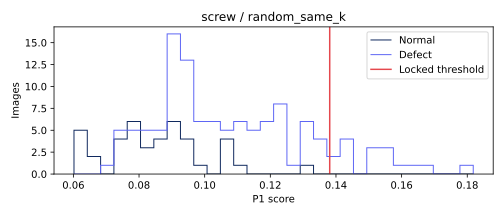

# screw · random_same_k 비전 진단

이미지 160개. TP 16, FN 103, FP 0, TN 41. 고정 임계값 0.1380936484783888.

## 점수 분포


정상/불량 점수 범위의 교집합(경계 포함): {'definition': 'intersection of empirical normal/defect score ranges (inclusive)', 'range': [0.06891757249832153, 0.13084882497787476], 'normal_count': 34, 'defect_count': 97}. 확률적 중첩률이나 원인 판정이 아니다.

## 결함 유형별 성능
|유형|이미지|NG|탐지율(정상은 오탐률)|평균 점수|
|---|---:|---:|---:|---:|
|good|41|0|0.000000|0.085237723|
|manipulated_front|24|1|0.041667|0.109940742|
|scratch_head|24|1|0.041667|0.105270982|
|scratch_neck|25|13|0.520000|0.135179484|
|thread_side|23|0|0.000000|0.090900789|
|thread_top|23|1|0.043478|0.100711465|

## 배경 반응과 한계
오탐의 최대 raw 패치 반응이 배경 proxy에 있었던 비율: 0/0. 분모 0은 해당 없음.
정상 fit 이미지의 테두리 RGB 중앙값과의 색 거리 히스토그램에 Otsu를 적용한 고정 임계값이다. 테스트 이미지/GT로 튜닝하지 않았다. 이는 물체 GT가 아닌 색 기반 proxy다. 물체와 배경의 색이 비슷하거나 질감이 화면을 채우는 carpet에서는 특히 신뢰할 수 없다. 배경 간섭의 인과관계를 단정하지 않는다.

## 공정 영향
[600,3600] 본 라인 출구 전체(보류 포함)를 분모로 기존 reconstruct_b 결과를 인용한다. 사람 1명·30초·민감도/특이도 1 assumed. 파일럿 조건이 서로 달라 모델 효과의 직접 비교가 아니다.
```json
[
  {
    "run_id": "05b9f3ba8b2b4165",
    "cell": "inline",
    "speed": 1.0,
    "seed": 0,
    "latency_mode": "profile",
    "source_complete_sha256": "98f73040b50c9d8111706e06fbfd30ac5ccb1b2bb55a702dd34aee19601ffa8b",
    "parts_denominator": 29032,
    "reinspection_per_1000": 6.027831358500964,
    "false_positives_per_1000": 0.0,
    "escaped_defects": 1275,
    "escaped_defects_per_1000": 43.917057040507025
  },
  {
    "run_id": "e5bfa5b97b63d95a",
    "cell": "inline",
    "speed": 0.25,
    "seed": 0,
    "latency_mode": "constant",
    "source_complete_sha256": "d85289ec82db148750035c37521287cadb3b59541bf9637173d00f087c6e3860",
    "parts_denominator": 7283,
    "reinspection_per_1000": 4.668405876699163,
    "false_positives_per_1000": 0.0,
    "escaped_defects": 306,
    "escaped_defects_per_1000": 42.015652890292465
  }
]
```

## 오탐·미탐 갤러리
오탐은 점수 상위 8개, 미탐은 전부. 원본 외 비교 이미지는 짧은 변 256 resize → 중앙 224 crop 좌표로 정렬했다. GT 마스크는 보고서 표시 전용이다. 히트맵은 기존 EvidenceStore의 이미지별 min/max 상대 표시다.

### FN · screw/test/manipulated_front/000.png
점수 0.09513258934020996 · 임계값 0.1380936484783888 · 판정 OK · 최대 패치 [27, 11]
[원본](outputs/factory-evidence/03e62636cfbf9b5639fe7b24cb6c2813/source.png) ·    

### FN · screw/test/manipulated_front/001.png
점수 0.11810410022735596 · 임계값 0.1380936484783888 · 판정 OK · 최대 패치 [23, 25]
[원본](outputs/factory-evidence/4abeb815e05f3131ec70979c814dce0c/source.png) ·    

### FN · screw/test/manipulated_front/002.png
점수 0.1351778507232666 · 임계값 0.1380936484783888 · 판정 OK · 최대 패치 [14, 0]
[원본](outputs/factory-evidence/6ba9136a9de377b0b79fd7b467be89f4/source.png) ·    

### FN · screw/test/manipulated_front/003.png
점수 0.09497123956680298 · 임계값 0.1380936484783888 · 판정 OK · 최대 패치 [2, 8]
[원본](outputs/factory-evidence/d2fff6b6582e1b6c986160d4fb0427f1/source.png) ·    

### FN · screw/test/manipulated_front/004.png
점수 0.11113399267196655 · 임계값 0.1380936484783888 · 판정 OK · 최대 패치 [23, 0]
[원본](outputs/factory-evidence/d9ea6b2290e0baa7727e40e3a501d838/source.png) ·    

### FN · screw/test/manipulated_front/005.png
점수 0.13539087772369385 · 임계값 0.1380936484783888 · 판정 OK · 최대 패치 [20, 27]
[원본](outputs/factory-evidence/fdcb503f22a14ebf73120911fb5a1362/source.png) ·    

### FN · screw/test/manipulated_front/006.png
점수 0.08957791328430176 · 임계값 0.1380936484783888 · 판정 OK · 최대 패치 [3, 24]
[원본](outputs/factory-evidence/f112db4d1427d96b289179889c2e5ed1/source.png) ·    

### FN · screw/test/manipulated_front/007.png
점수 0.09586232900619507 · 임계값 0.1380936484783888 · 판정 OK · 최대 패치 [2, 21]
[원본](outputs/factory-evidence/1f89a1732a09affc1bbf2a9cf9f67047/source.png) ·    

### FN · screw/test/manipulated_front/008.png
점수 0.13063400983810425 · 임계값 0.1380936484783888 · 판정 OK · 최대 패치 [11, 0]
[원본](outputs/factory-evidence/156a774712c8755b821ea4bb81efc813/source.png) ·    

### FN · screw/test/manipulated_front/009.png
점수 0.09474003314971924 · 임계값 0.1380936484783888 · 판정 OK · 최대 패치 [2, 24]
[원본](outputs/factory-evidence/9e975b0fe8c5d5948f8d2ed7002b12dd/source.png) ·    

### FN · screw/test/manipulated_front/010.png
점수 0.10414814949035645 · 임계값 0.1380936484783888 · 판정 OK · 최대 패치 [0, 20]
[원본](outputs/factory-evidence/eda60ed3de23c1f1017756ee24d93b42/source.png) ·    

### FN · screw/test/manipulated_front/011.png
점수 0.12467610836029053 · 임계값 0.1380936484783888 · 판정 OK · 최대 패치 [27, 7]
[원본](outputs/factory-evidence/75ac092760c2d064959fef8c68bb04e4/source.png) ·    

### FN · screw/test/manipulated_front/012.png
점수 0.1213221549987793 · 임계값 0.1380936484783888 · 판정 OK · 최대 패치 [13, 0]
[원본](outputs/factory-evidence/517e145b8753705869f49ab92f8af4e8/source.png) ·    

### FN · screw/test/manipulated_front/013.png
점수 0.08932709693908691 · 임계값 0.1380936484783888 · 판정 OK · 최대 패치 [23, 25]
[원본](outputs/factory-evidence/59980656a8282bf548a4e65ad7414039/source.png) ·    

### FN · screw/test/manipulated_front/014.png
점수 0.10366487503051758 · 임계값 0.1380936484783888 · 판정 OK · 최대 패치 [5, 1]
[원본](outputs/factory-evidence/3594e7f3cc929bab89f9d0b93ad5241f/source.png) ·    

### FN · screw/test/manipulated_front/015.png
점수 0.13020086288452148 · 임계값 0.1380936484783888 · 판정 OK · 최대 패치 [0, 16]
[원본](outputs/factory-evidence/e93488b83aa92e20b4a7c8da42c0632e/source.png) ·    

### FN · screw/test/manipulated_front/016.png
점수 0.09573036432266235 · 임계값 0.1380936484783888 · 판정 OK · 최대 패치 [10, 26]
[원본](outputs/factory-evidence/53a9e016e5478a8e9b24c84be356b9cf/source.png) ·    

### FN · screw/test/manipulated_front/017.png
점수 0.11697322130203247 · 임계값 0.1380936484783888 · 판정 OK · 최대 패치 [26, 6]
[원본](outputs/factory-evidence/0ad682055bad90d0a59407f40a3c0372/source.png) ·    

### FN · screw/test/manipulated_front/019.png
점수 0.10999459028244019 · 임계값 0.1380936484783888 · 판정 OK · 최대 패치 [27, 16]
[원본](outputs/factory-evidence/8ed6bf3994d1ff7ac37d92db09c7a658/source.png) ·    

### FN · screw/test/manipulated_front/020.png
점수 0.08424508571624756 · 임계값 0.1380936484783888 · 판정 OK · 최대 패치 [3, 27]
[원본](outputs/factory-evidence/0775393cc45fb17740db28891d09020b/source.png) ·    

### FN · screw/test/manipulated_front/021.png
점수 0.10898017883300781 · 임계값 0.1380936484783888 · 판정 OK · 최대 패치 [26, 5]
[원본](outputs/factory-evidence/8b45c17075b971d60c60c14268040714/source.png) ·    

### FN · screw/test/manipulated_front/022.png
점수 0.11365675926208496 · 임계값 0.1380936484783888 · 판정 OK · 최대 패치 [19, 27]
[원본](outputs/factory-evidence/bc309cba8d5948b5cf65457de86f4ecf/source.png) ·    

### FN · screw/test/manipulated_front/023.png
점수 0.09473621845245361 · 임계값 0.1380936484783888 · 판정 OK · 최대 패치 [0, 18]
[원본](outputs/factory-evidence/cf5193177e7a75265a5cdd855c1d33ff/source.png) ·    

### FN · screw/test/scratch_head/000.png
점수 0.09215223789215088 · 임계값 0.1380936484783888 · 판정 OK · 최대 패치 [7, 5]
[원본](outputs/factory-evidence/ff9498fbe37611a6453f2838d2062816/source.png) ·    

### FN · screw/test/scratch_head/001.png
점수 0.11773967742919922 · 임계값 0.1380936484783888 · 판정 OK · 최대 패치 [27, 16]
[원본](outputs/factory-evidence/ba3f6b544a261d207090b46240b61a05/source.png) ·    

### FN · screw/test/scratch_head/002.png
점수 0.0932726263999939 · 임계값 0.1380936484783888 · 판정 OK · 최대 패치 [20, 0]
[원본](outputs/factory-evidence/59d0fc8c12555cd65fb421fca640c74a/source.png) ·    

### FN · screw/test/scratch_head/003.png
점수 0.09008324146270752 · 임계값 0.1380936484783888 · 판정 OK · 최대 패치 [14, 0]
[원본](outputs/factory-evidence/ade515304b1c34bb89dbe8162a68096a/source.png) ·    

### FN · screw/test/scratch_head/004.png
점수 0.07630854845046997 · 임계값 0.1380936484783888 · 판정 OK · 최대 패치 [20, 5]
[원본](outputs/factory-evidence/5c44fe627c160284ea53f5d62f0e2776/source.png) ·    

### FN · screw/test/scratch_head/005.png
점수 0.09735453128814697 · 임계값 0.1380936484783888 · 판정 OK · 최대 패치 [26, 15]
[원본](outputs/factory-evidence/d3c23ea0b833d4231b7ce7f9777e1df4/source.png) ·    

### FN · screw/test/scratch_head/006.png
점수 0.1166985034942627 · 임계값 0.1380936484783888 · 판정 OK · 최대 패치 [8, 23]
[원본](outputs/factory-evidence/922792f2d3da6daf6a6d72e177c19207/source.png) ·    

### FN · screw/test/scratch_head/007.png
점수 0.12943416833877563 · 임계값 0.1380936484783888 · 판정 OK · 최대 패치 [0, 14]
[원본](outputs/factory-evidence/984529a7b8fc931ef382deb098f7319c/source.png) ·    

### FN · screw/test/scratch_head/008.png
점수 0.08007878065109253 · 임계값 0.1380936484783888 · 판정 OK · 최대 패치 [5, 8]
[원본](outputs/factory-evidence/d8266c8051bb38838b97f9719c6bfd3b/source.png) ·    

### FN · screw/test/scratch_head/009.png
점수 0.0918121337890625 · 임계값 0.1380936484783888 · 판정 OK · 최대 패치 [13, 2]
[원본](outputs/factory-evidence/6eba7b1d1aefad877c56247b81204252/source.png) ·    

### FN · screw/test/scratch_head/010.png
점수 0.0958104133605957 · 임계값 0.1380936484783888 · 판정 OK · 최대 패치 [23, 15]
[원본](outputs/factory-evidence/658014ddc07dd8c1eaab137e11416891/source.png) ·    

### FN · screw/test/scratch_head/011.png
점수 0.13422006368637085 · 임계값 0.1380936484783888 · 판정 OK · 최대 패치 [25, 17]
[원본](outputs/factory-evidence/96c94ad58d8276461b45adffa98ad708/source.png) ·    

### FN · screw/test/scratch_head/012.png
점수 0.09562569856643677 · 임계값 0.1380936484783888 · 판정 OK · 최대 패치 [14, 0]
[원본](outputs/factory-evidence/7ffbc5347e041e073edb3d32c5bc0d38/source.png) ·    

### FN · screw/test/scratch_head/013.png
점수 0.11616003513336182 · 임계값 0.1380936484783888 · 판정 OK · 최대 패치 [8, 23]
[원본](outputs/factory-evidence/636e2e54f5c16d22f019a4ddf9acc210/source.png) ·    

### FN · screw/test/scratch_head/014.png
점수 0.08924990892410278 · 임계값 0.1380936484783888 · 판정 OK · 최대 패치 [2, 12]
[원본](outputs/factory-evidence/d0a3c3e3e16122403e3f95884c496094/source.png) ·    

### FN · screw/test/scratch_head/015.png
점수 0.12198662757873535 · 임계값 0.1380936484783888 · 판정 OK · 최대 패치 [11, 2]
[원본](outputs/factory-evidence/abc03276e9c75e84f94d447f77746f85/source.png) ·    

### FN · screw/test/scratch_head/016.png
점수 0.12356573343276978 · 임계값 0.1380936484783888 · 판정 OK · 최대 패치 [27, 15]
[원본](outputs/factory-evidence/817867c3a25b24899a5f33c5d48c0e68/source.png) ·    

### FN · screw/test/scratch_head/017.png
점수 0.11233353614807129 · 임계값 0.1380936484783888 · 판정 OK · 최대 패치 [11, 27]
[원본](outputs/factory-evidence/771f162b46e18ffe7f997731e6bc7206/source.png) ·    

### FN · screw/test/scratch_head/018.png
점수 0.11381042003631592 · 임계값 0.1380936484783888 · 판정 OK · 최대 패치 [14, 27]
[원본](outputs/factory-evidence/bdf536060a57f419e4e27f978cb6b6be/source.png) ·    

### FN · screw/test/scratch_head/020.png
점수 0.09525942802429199 · 임계값 0.1380936484783888 · 판정 OK · 최대 패치 [0, 12]
[원본](outputs/factory-evidence/996a6589363829b518fb4b068fe230ee/source.png) ·    

### FN · screw/test/scratch_head/021.png
점수 0.0943787693977356 · 임계값 0.1380936484783888 · 판정 OK · 최대 패치 [22, 14]
[원본](outputs/factory-evidence/341e9258726ded3961367e53b8858f1f/source.png) ·    

### FN · screw/test/scratch_head/022.png
점수 0.11796802282333374 · 임계값 0.1380936484783888 · 판정 OK · 최대 패치 [0, 10]
[원본](outputs/factory-evidence/c8d07eb214418e3fedef7d8e9491e15c/source.png) ·    

### FN · screw/test/scratch_head/023.png
점수 0.09208428859710693 · 임계값 0.1380936484783888 · 판정 OK · 최대 패치 [8, 23]
[원본](outputs/factory-evidence/a4ae49fc4e09aa336fd1db0f35dbb8d1/source.png) ·    

### FN · screw/test/scratch_neck/000.png
점수 0.09087800979614258 · 임계값 0.1380936484783888 · 판정 OK · 최대 패치 [7, 11]
[원본](outputs/factory-evidence/74e6a617735d533361804d5b2c9d27e0/source.png) ·    

### FN · screw/test/scratch_neck/001.png
점수 0.13305270671844482 · 임계값 0.1380936484783888 · 판정 OK · 최대 패치 [9, 11]
[원본](outputs/factory-evidence/45dd377871e9f8ab2788b80546f8e565/source.png) ·    

### FN · screw/test/scratch_neck/002.png
점수 0.11830800771713257 · 임계값 0.1380936484783888 · 판정 OK · 최대 패치 [11, 13]
[원본](outputs/factory-evidence/45a1426637db63bf51bdf325f49cf3f0/source.png) ·    

### FN · screw/test/scratch_neck/005.png
점수 0.07380557060241699 · 임계값 0.1380936484783888 · 판정 OK · 최대 패치 [25, 2]
[원본](outputs/factory-evidence/80a4439e2f9796c8655825dea60c1c21/source.png) ·    

### FN · screw/test/scratch_neck/010.png
점수 0.12249159812927246 · 임계값 0.1380936484783888 · 판정 OK · 최대 패치 [13, 12]
[원본](outputs/factory-evidence/e79e2de1521ff00166928998b8ab1177/source.png) ·    

### FN · screw/test/scratch_neck/011.png
점수 0.09884506464004517 · 임계값 0.1380936484783888 · 판정 OK · 최대 패치 [14, 11]
[원본](outputs/factory-evidence/cb8fbdd25c6e9da94fbf6c004d84f380/source.png) ·    

### FN · screw/test/scratch_neck/012.png
점수 0.13014304637908936 · 임계값 0.1380936484783888 · 판정 OK · 최대 패치 [12, 13]
[원본](outputs/factory-evidence/0677a28c197ffc976768ef0c1e8239b9/source.png) ·    

### FN · screw/test/scratch_neck/017.png
점수 0.13223129510879517 · 임계값 0.1380936484783888 · 판정 OK · 최대 패치 [11, 12]
[원본](outputs/factory-evidence/951d6d41d92b5e6a63c550fe52eae2d4/source.png) ·    

### FN · screw/test/scratch_neck/020.png
점수 0.12766432762145996 · 임계값 0.1380936484783888 · 판정 OK · 최대 패치 [9, 10]
[원본](outputs/factory-evidence/c3290e004f373f9f1cba75a843d4b7a4/source.png) ·    

### FN · screw/test/scratch_neck/021.png
점수 0.10851699113845825 · 임계값 0.1380936484783888 · 판정 OK · 최대 패치 [15, 14]
[원본](outputs/factory-evidence/eb0beaae4e411d1c47bf26a104dba22d/source.png) ·    

### FN · screw/test/scratch_neck/022.png
점수 0.11856585741043091 · 임계값 0.1380936484783888 · 판정 OK · 최대 패치 [12, 16]
[원본](outputs/factory-evidence/c14930db7b9a16477ae375d07684c4bb/source.png) ·    

### FN · screw/test/scratch_neck/023.png
점수 0.10238152742385864 · 임계값 0.1380936484783888 · 판정 OK · 최대 패치 [10, 10]
[원본](outputs/factory-evidence/1fc1fa6772935a8b97ba1fd2946a61d7/source.png) ·    

### FN · screw/test/thread_side/000.png
점수 0.07926660776138306 · 임계값 0.1380936484783888 · 판정 OK · 최대 패치 [11, 27]
[원본](outputs/factory-evidence/9d1e467c5c38da2e049d18f16b410cfb/source.png) ·    

### FN · screw/test/thread_side/001.png
점수 0.09078270196914673 · 임계값 0.1380936484783888 · 판정 OK · 최대 패치 [27, 10]
[원본](outputs/factory-evidence/f111aef4c10b80a9a4be5debdf275492/source.png) ·    

### FN · screw/test/thread_side/002.png
점수 0.09035426378250122 · 임계값 0.1380936484783888 · 판정 OK · 최대 패치 [13, 0]
[원본](outputs/factory-evidence/ffaccbace0bbf15842abb2b52b02c274/source.png) ·    

### FN · screw/test/thread_side/003.png
점수 0.10594350099563599 · 임계값 0.1380936484783888 · 판정 OK · 최대 패치 [19, 15]
[원본](outputs/factory-evidence/c199497ec23215e27fb9d7c4df83a168/source.png) ·    

### FN · screw/test/thread_side/004.png
점수 0.08430951833724976 · 임계값 0.1380936484783888 · 판정 OK · 최대 패치 [9, 23]
[원본](outputs/factory-evidence/3d86ed4accce0f72f61e2b86f26e1a09/source.png) ·    

### FN · screw/test/thread_side/005.png
점수 0.09302520751953125 · 임계값 0.1380936484783888 · 판정 OK · 최대 패치 [10, 11]
[원본](outputs/factory-evidence/237dcd9dd8a0b3e4b8c0b5a090d866b1/source.png) ·    

### FN · screw/test/thread_side/006.png
점수 0.08772200345993042 · 임계값 0.1380936484783888 · 판정 OK · 최대 패치 [10, 11]
[원본](outputs/factory-evidence/56b7fb85868edd70fd6b4a3676e8f47c/source.png) ·    

### FN · screw/test/thread_side/007.png
점수 0.10761559009552002 · 임계값 0.1380936484783888 · 판정 OK · 최대 패치 [16, 15]
[원본](outputs/factory-evidence/c7e2b954289fb1a8ed63999d25053e23/source.png) ·    

### FN · screw/test/thread_side/008.png
점수 0.07695728540420532 · 임계값 0.1380936484783888 · 판정 OK · 최대 패치 [20, 9]
[원본](outputs/factory-evidence/54450510b11d26a866debab1f1b58b3c/source.png) ·    

### FN · screw/test/thread_side/009.png
점수 0.08657991886138916 · 임계값 0.1380936484783888 · 판정 OK · 최대 패치 [27, 0]
[원본](outputs/factory-evidence/6118e46a12467d654215d33036f1dd38/source.png) ·    

### FN · screw/test/thread_side/010.png
점수 0.0741925835609436 · 임계값 0.1380936484783888 · 판정 OK · 최대 패치 [16, 15]
[원본](outputs/factory-evidence/e04b4eb6eb9fd2adee32d97008be16ef/source.png) ·    

### FN · screw/test/thread_side/011.png
점수 0.12299174070358276 · 임계값 0.1380936484783888 · 판정 OK · 최대 패치 [27, 15]
[원본](outputs/factory-evidence/26c33161e281023033814871246331b5/source.png) ·    

### FN · screw/test/thread_side/012.png
점수 0.08792662620544434 · 임계값 0.1380936484783888 · 판정 OK · 최대 패치 [27, 2]
[원본](outputs/factory-evidence/b555a9a49592a32fd54cf3f4183e5a55/source.png) ·    

### FN · screw/test/thread_side/013.png
점수 0.08059149980545044 · 임계값 0.1380936484783888 · 판정 OK · 최대 패치 [27, 1]
[원본](outputs/factory-evidence/f14e55892441e4982496ab0eee6c27d3/source.png) ·    

### FN · screw/test/thread_side/014.png
점수 0.0849541425704956 · 임계값 0.1380936484783888 · 판정 OK · 최대 패치 [12, 10]
[원본](outputs/factory-evidence/ba2e76a888bcf957403757e529c976b2/source.png) ·    

### FN · screw/test/thread_side/015.png
점수 0.12134820222854614 · 임계값 0.1380936484783888 · 판정 OK · 최대 패치 [27, 15]
[원본](outputs/factory-evidence/d9b206b0db3353f031ce4aca14317cba/source.png) ·    

### FN · screw/test/thread_side/016.png
점수 0.08860844373703003 · 임계값 0.1380936484783888 · 판정 OK · 최대 패치 [27, 10]
[원본](outputs/factory-evidence/1d3dfc1173176a2ed7ff2badc16bb26e/source.png) ·    

### FN · screw/test/thread_side/017.png
점수 0.10218530893325806 · 임계값 0.1380936484783888 · 판정 OK · 최대 패치 [16, 6]
[원본](outputs/factory-evidence/c71ea200c49a4d999302e32aa308e502/source.png) ·    

### FN · screw/test/thread_side/018.png
점수 0.10189402103424072 · 임계값 0.1380936484783888 · 판정 OK · 최대 패치 [5, 27]
[원본](outputs/factory-evidence/6d78cae2b5c4ce24b342c32d925a103a/source.png) ·    

### FN · screw/test/thread_side/019.png
점수 0.080272376537323 · 임계값 0.1380936484783888 · 판정 OK · 최대 패치 [2, 27]
[원본](outputs/factory-evidence/54866b512e7edc72c3fbac633cc10ce7/source.png) ·    

### FN · screw/test/thread_side/020.png
점수 0.07428020238876343 · 임계값 0.1380936484783888 · 판정 OK · 최대 패치 [17, 1]
[원본](outputs/factory-evidence/5d188233a0a6188709e6d557340452bb/source.png) ·    

### FN · screw/test/thread_side/021.png
점수 0.06891757249832153 · 임계값 0.1380936484783888 · 판정 OK · 최대 패치 [21, 18]
[원본](outputs/factory-evidence/5de818e857cd1491e14d4f111b3f9830/source.png) ·    

### FN · screw/test/thread_side/022.png
점수 0.0999988317489624 · 임계값 0.1380936484783888 · 판정 OK · 최대 패치 [22, 14]
[원본](outputs/factory-evidence/0b6ef9c7a31f2ea4647b3a39c85f11d1/source.png) ·    

### FN · screw/test/thread_top/000.png
점수 0.0905146598815918 · 임계값 0.1380936484783888 · 판정 OK · 최대 패치 [7, 8]
[원본](outputs/factory-evidence/4ca839e149f582cf67d047673b6d227b/source.png) ·    

### FN · screw/test/thread_top/001.png
점수 0.10600727796554565 · 임계값 0.1380936484783888 · 판정 OK · 최대 패치 [16, 10]
[원본](outputs/factory-evidence/f7834dcf9dee8169ac0235b19640c0e1/source.png) ·    

### FN · screw/test/thread_top/002.png
점수 0.1104620099067688 · 임계값 0.1380936484783888 · 판정 OK · 최대 패치 [9, 18]
[원본](outputs/factory-evidence/7ab959860f83596e73a66e636ad99580/source.png) ·    

### FN · screw/test/thread_top/003.png
점수 0.07646560668945312 · 임계값 0.1380936484783888 · 판정 OK · 최대 패치 [8, 22]
[원본](outputs/factory-evidence/939615c550ee113ebf9d715773ef5115/source.png) ·    

### FN · screw/test/thread_top/004.png
점수 0.11089277267456055 · 임계값 0.1380936484783888 · 판정 OK · 최대 패치 [18, 16]
[원본](outputs/factory-evidence/c04ec2653cb8fa2c15812bf403a90336/source.png) ·    

### FN · screw/test/thread_top/005.png
점수 0.1365923285484314 · 임계값 0.1380936484783888 · 판정 OK · 최대 패치 [15, 14]
[원본](outputs/factory-evidence/ae44590d5f61ccc199d2f78339f8b6bf/source.png) ·    

### FN · screw/test/thread_top/006.png
점수 0.10500884056091309 · 임계값 0.1380936484783888 · 판정 OK · 최대 패치 [8, 19]
[원본](outputs/factory-evidence/ab0e7b94a17f879b57169b078650a725/source.png) ·    

### FN · screw/test/thread_top/008.png
점수 0.09148925542831421 · 임계값 0.1380936484783888 · 판정 OK · 최대 패치 [9, 0]
[원본](outputs/factory-evidence/433c6c2dc46070eadb786c32b506f407/source.png) ·    

### FN · screw/test/thread_top/009.png
점수 0.0920339822769165 · 임계값 0.1380936484783888 · 판정 OK · 최대 패치 [0, 22]
[원본](outputs/factory-evidence/375377af12d3f3c4f7e42677343458f6/source.png) ·    

### FN · screw/test/thread_top/010.png
점수 0.0824388861656189 · 임계값 0.1380936484783888 · 판정 OK · 최대 패치 [18, 15]
[원본](outputs/factory-evidence/838e9087aa3510c23b21ca98fad3cf14/source.png) ·    

### FN · screw/test/thread_top/011.png
점수 0.09766852855682373 · 임계값 0.1380936484783888 · 판정 OK · 최대 패치 [11, 17]
[원본](outputs/factory-evidence/0c8ebb08596b809f0a74326045dbf541/source.png) ·    

### FN · screw/test/thread_top/012.png
점수 0.0897676944732666 · 임계값 0.1380936484783888 · 판정 OK · 최대 패치 [7, 0]
[원본](outputs/factory-evidence/af81a9d14ed266cbcadbdd2d74a0cfa3/source.png) ·    

### FN · screw/test/thread_top/013.png
점수 0.09224188327789307 · 임계값 0.1380936484783888 · 판정 OK · 최대 패치 [13, 8]
[원본](outputs/factory-evidence/c24c114e0a87edca3c0b541945b2d55a/source.png) ·    

### FN · screw/test/thread_top/014.png
점수 0.07597184181213379 · 임계값 0.1380936484783888 · 판정 OK · 최대 패치 [18, 17]
[원본](outputs/factory-evidence/a2af4bd99f1545997ecf5f32c67378b5/source.png) ·    

### FN · screw/test/thread_top/015.png
점수 0.09932494163513184 · 임계값 0.1380936484783888 · 판정 OK · 최대 패치 [21, 27]
[원본](outputs/factory-evidence/23da6522636f75ccefa56f838031c59d/source.png) ·    

### FN · screw/test/thread_top/016.png
점수 0.09920048713684082 · 임계값 0.1380936484783888 · 판정 OK · 최대 패치 [17, 3]
[원본](outputs/factory-evidence/101069abb013f4cec196447ed20c48d7/source.png) ·    

### FN · screw/test/thread_top/017.png
점수 0.09288018941879272 · 임계값 0.1380936484783888 · 판정 OK · 최대 패치 [27, 17]
[원본](outputs/factory-evidence/b4c567ced24ef5ce63a11ad727ff56a0/source.png) ·    

### FN · screw/test/thread_top/018.png
점수 0.10262513160705566 · 임계값 0.1380936484783888 · 판정 OK · 최대 패치 [24, 16]
[원본](outputs/factory-evidence/77d87a7429cfd56f79be09a7dd1b9d2c/source.png) ·    

### FN · screw/test/thread_top/019.png
점수 0.12394833564758301 · 임계값 0.1380936484783888 · 판정 OK · 최대 패치 [17, 21]
[원본](outputs/factory-evidence/87af877e8136a44ca6ec74b9ed6827b4/source.png) ·    

### FN · screw/test/thread_top/020.png
점수 0.11613249778747559 · 임계값 0.1380936484783888 · 판정 OK · 최대 패치 [16, 5]
[원본](outputs/factory-evidence/4f0762dbc797a93c8ca246260042ce4d/source.png) ·    

### FN · screw/test/thread_top/021.png
점수 0.08773112297058105 · 임계값 0.1380936484783888 · 판정 OK · 최대 패치 [19, 18]
[원본](outputs/factory-evidence/5b086f5ee85eb0fd6109eadd8f7533aa/source.png) ·    

### FN · screw/test/thread_top/022.png
점수 0.08358991146087646 · 임계값 0.1380936484783888 · 판정 OK · 최대 패치 [4, 23]
[원본](outputs/factory-evidence/634dcd07dade4228bc6e7f23f8f7cd0f/source.png) ·    

## 모델 간 차이
클래스 상위 REPORT.md와 report.json의 disagreements에 세 모델의 점수·판정을 같은 이미지 ID로 대조했다.
